# [课程笔记] 局域表面等离激元（LSP）：准静态近似、Fröhlich 条件，以及为什么“小球”总是金属的

> **一句话概括**：把 LSP 从“准静态近似为什么成立”一路推到“极化率 α、Fröhlich 条件、场增强”，中间补齐了课件跳过的拉普拉斯方程系数代数；核心结论是共振要求 $\mathrm{Re}\,\varepsilon=-2\varepsilon_m$，而环境介质 $\varepsilon_m>0$，所以提供负介电常数的那一方只能是金属。传播型 SPP 的内容见配套笔记《[表面等离激元极化激元（SPPs）](/Learning/2026/10/27/course-SPP-plasmonics.html)》。

---

## 基本信息

| 项目 | 内容 |
|---|---|
| **笔记性质** | 课程笔记（专题整理），由原 SPP 笔记第 12 节拆出并大幅扩写 |
| **依据** | 课程 PPT（SOOCHOW UNIVERSITY）LSP 章节，对应教材 §5.1–5.2；另含 2026-11-10 讲前半段 |
| **参考教材** | Maier, *Plasmonics: Fundamentals and Applications*, Springer, 2007，第 5 章 |
| **内容主线** | 两类等离激元的分工 → 准静态近似 → 拉普拉斯方程与边界条件 → 极化率 → 退极化场视角 → 为什么必须是金属 → Fröhlich 条件 → 场增强与截面 → 形状/尺寸调谐 |
| **配套图** | 4 张按公式重绘的计算图 + 7 张课件原片 |
| **配套笔记** | 《表面等离激元极化激元（SPPs）：从 Drude 模型到亚波长光刻》 |

---

## 目录

1. [两类表面等离激元：传播的与局域的](#1-两类表面等离激元传播的与局域的)
2. [准静态近似：什么时候可以把光当静电场](#2-准静态近似什么时候可以把光当静电场)
3. [解拉普拉斯方程](#3-解拉普拉斯方程)
4. [偶极子、极化率与 Clausius–Mossotti](#4-偶极子极化率与-clausiusmossotti)
5. [换一条路：用退极化场重推共振条件](#5-换一条路用退极化场重推共振条件)
6. [为什么“纳米小球”几乎都是金属球](#6-为什么纳米小球几乎都是金属球)
7. [Fröhlich 条件与共振频率](#7-fröhlich-条件与共振频率)
8. [场增强与截面](#8-场增强与截面)
9. [形状与尺寸：另外两个旋钮](#9-形状与尺寸另外两个旋钮)
10. [应用](#10-应用)
11. [公式速查表](#11-公式速查表)
12. [常见误区与自检题](#12-常见误区与自检题)

---

## 记号约定

| 符号 | 含义 | 备注 |
| --- | --- | --- |
| $a$ | 球的半径 | 直径 $d=2a$ |
| $\varepsilon(\omega)$ | 球的介电函数（复数） | 金属时为负实部 |
| $\varepsilon_m$ | 环境介质的介电常数（实数、正） | 空气 1，水 1.77，石英 2.25 |
| $\lambda$ | 环境介质中的光波长 | 判据用 $\lambda$，不是 $\lambda_0$ |
| $\mathbf{E}_0$ | 外加均匀静电场 | 取 $\hat{\mathbf{z}}$ 方向 |
| $\Phi$ | 电势，$\mathbf{E}=-\nabla\Phi$ | 单位 V |
| $\alpha$ | 极化率，$\mathbf{p}=\varepsilon_0\varepsilon_m\alpha\mathbf{E}_0$ | 量纲为体积 |
| $\mathbf{p}$ | 感应偶极矩 | |
| $L_i$ | 退极化因子 | 球 $L=1/3$ |
| $\omega_p$ | 体等离子体频率 | |
| $\gamma$ | 碰撞频率 | 尺寸小到 10 nm 时要加修正 |

---

## 1. 两类表面等离激元：传播的与局域的

### 1.1 定义与分工

表面等离激元只有两大类，物理同源，行为完全不同。

| | 传播型 SPP | 局域型 LSP |
| --- | --- | --- |
| **全称** | Surface Plasmon Polariton | Localized Surface Plasmon |
| **载体** | 连续的金属/介质**界面**（半空间或薄膜） | 分立的金属**纳米颗粒/纳米结构** |
| **传播** | 沿界面传播，有明确的 $\beta$ | 不传播，原地振荡 |
| **共振条件** | $\varepsilon_1+\varepsilon_2=0$（或色散关系 $\beta=k_0\sqrt{\varepsilon_1\varepsilon_2/(\varepsilon_1+\varepsilon_2)}$） | $\mathrm{Re}\,\varepsilon=-2\varepsilon_m$（球） |
| **激发** | 需要动量补偿（棱镜、光栅、近场探针） | 可直接用光照射激发 |
| **光谱** | 连续，随 $\omega$ 变化 | 分立共振，随尺寸、形状、环境移动 |
| **场约束** | 一维（垂直界面） | 三维，可小于 $\lambda^3/1000$ |

  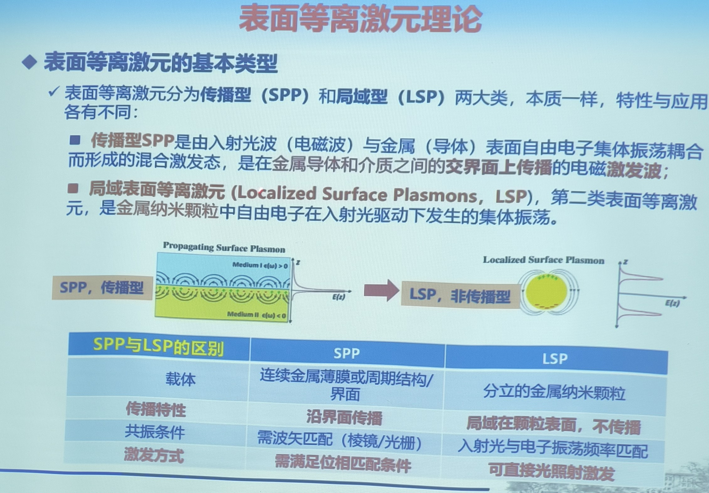

*课件原片：左边是传播型 SPP 的场分布（两侧指数衰减，沿界面跑），右边是 LSP 的场分布（颗粒两侧反对称，出不了颗粒表面）*

> **一句话分界**：SPP 是“沿着界面跑的波”，LSP 是“原地晃的振子”。前者要动量补偿，后者不用。这条差别在第 6 节和第 12 节都会回到同一个原因上，也就是平移对称性。

### 1.2 曲面带来的两件新东西

课件把 LSP 的独特性归结为“曲面”，这一点值得展开，因为后面所有公式都能追到这两个后果上。

**后果一：曲面提供恢复力。**
平面界面上被推开的电子，其恢复力完全来自金属内部的正电荷背景，界面的几何不提供额外的约束。球面上，电子沿表面堆积后，表面电荷自己会产生一个**指向球心的退极化场**，这个场与外加场方向相反，等效于一根额外的弹簧。于是球有了一个**本征频率**，这就是共振的来源（第 5 节会定量算）。

**后果二：曲面破坏平移对称性，于是可以直接用光激发。**
平面界面上 $k_x$ 严格守恒，而 SPP 的 $\beta$ 大于 $k_0\sqrt{\varepsilon_2}$，自由空间光永远够不到（配套笔记第 8 节）。球不是平移不变的，它的几何尺寸 $a$ 就把场在空间上截断了，按傅里叶关系必然含有 $\sim 1/a$ 量级的波矢分量。换句话说，**颗粒本身就是一台动量补偿器**，所以不需要棱镜、不需要光栅。

  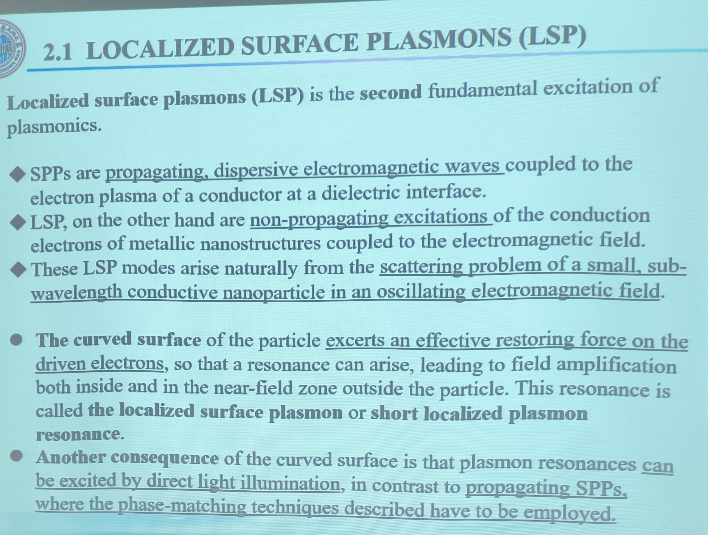

*课件原片（教材 §2.1 原文）：把“曲面提供恢复力”和“曲面使共振可被直接激发”这两条并列写出。这两句就是本节 1.2 的全部依据*

---

## 2. 准静态近似：什么时候可以把光当静电场

### 2.1 判据

条件是颗粒尺寸远小于**环境介质中**的光波长：

$$
d=2a\ll\lambda=\frac{\lambda_0}{n_m}.
\tag{2.1}
$$

这时电磁波在颗粒尺度上的相位变化可以忽略，可以认为**外场在颗粒体积内处处同相**：

$$
e^{ikz}\approx1\quad(|kz|\lesssim k a\ll1).
\tag{2.2}
$$

于是整个问题退化成静电学：解 $\nabla^2\Phi=0$，解完之后再把时间因子 $e^{-i\omega t}$ 乘回去。

### 2.2 数量级

| 场景 | $\lambda_0$ | $\lambda$（水中） | $a=10$ nm 时的 $a/\lambda$ | 准静态可用？ |
| --- | --- | --- | --- | --- |
| 紫外 | 350 nm | 263 nm | 0.038 | 好 |
| 可见 | 550 nm | 414 nm | 0.024 | 好 |
| 近红外 | 1000 nm | 752 nm | 0.013 | 很好 |

课件给的实用界限是 $d<100$ nm（即 $a<50$ nm）时，最低阶近似对多数用途够用。这个数字的含义是 $a/\lambda\lesssim0.1$。

> **注意**：判据里的 $\lambda$ 是**介质中**的波长，不是真空波长。同一个颗粒放在水里，$\lambda$ 缩短 $n_m$ 倍，准静态近似反而更容易满足；但共振频率会红移（第 7 节）。

### 2.3 什么时候不够用

三条边界，任何一条被越过就要上 Mie 理论：

1. $a\gtrsim\lambda/10$：相位延迟不可忽略，出现**四极及高阶模**，共振红移并且展宽；
2. 颗粒不是球形（椭球、立方、星形）：准静态仍然可用，但要把 $1/3$ 换成对应的退极化因子（第 9 节）；
3. 颗粒之间有强耦合（二聚体、阵列）：单个球的解不再适用，要解多体问题，耦合会让共振分裂成成键/反键两支。

---

## 3. 解拉普拉斯方程

  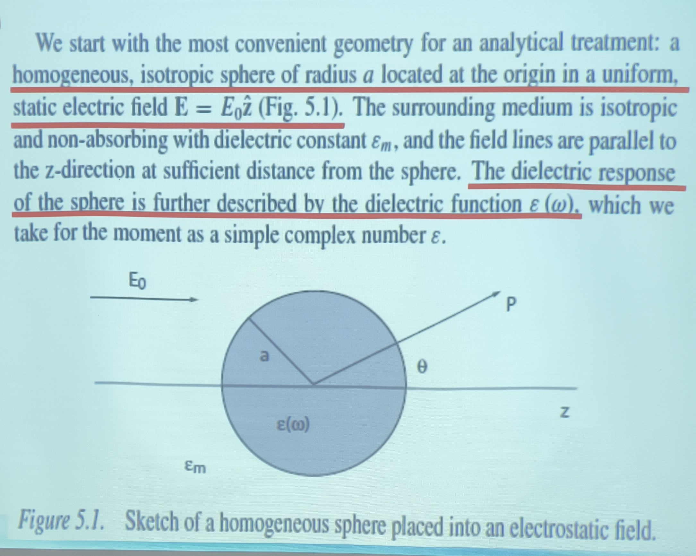

*课件原片（教材 Fig. 5.1）：半径 $a$、介电函数 $\varepsilon(\omega)$ 的球，置于介电常数 $\varepsilon_m$ 的各向同性无吸收介质中，外场 $\mathbf{E}_0=E_0\hat{\mathbf{z}}$*

### 3.1 通解

球坐标下，方位角对称（$\partial_\phi=0$）时拉普拉斯方程 $\nabla^2\Phi=0$ 的通解是

$$
\Phi(r,\theta)=\sum_{l=0}^{\infty}\left[A_l r^{l}+B_l r^{-(l+1)}\right]P_l(\cos\theta),
\tag{3.1}
$$

$P_l$ 是 Legendre 多项式。**球内要求 $r\to0$ 时有限**，所以 $B_l\equiv0$；球外要求 $r\to\infty$ 时回到外加场，所以保留两项。于是

$$
\Phi_{\mathrm{in}}=\sum_{l=0}^{\infty}A_l r^{l}P_l(\cos\theta),
\qquad
\Phi_{\mathrm{out}}=\sum_{l=0}^{\infty}\left[B_l r^{l}+C_l r^{-(l+1)}\right]P_l(\cos\theta).
\tag{3.2}
$$

**这就是课件式 (5.1)(5.2)。**

  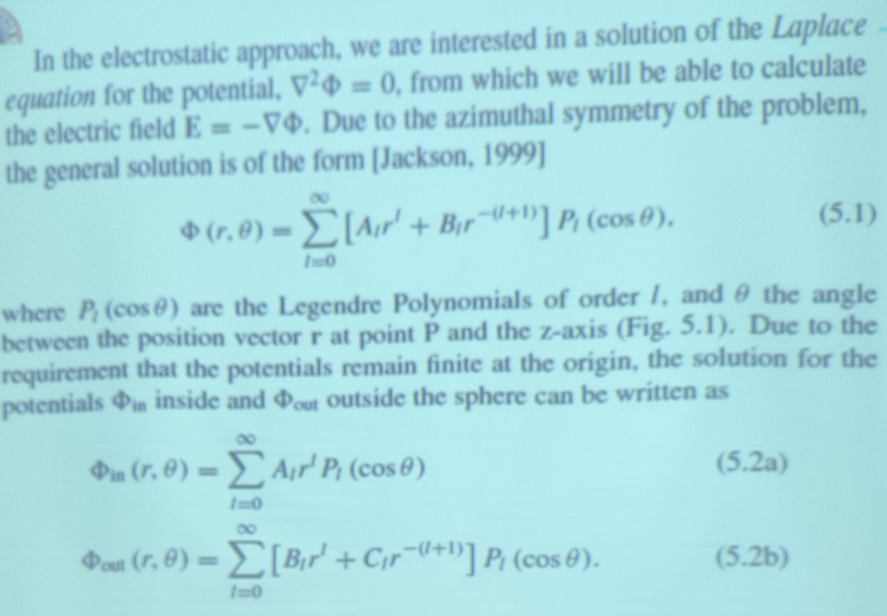

*课件原片：注意通解里 $r^{l}$ 与 $r^{-(l+1)}$ 是成对出现的，前者管球内（$r\to0$ 有限），后者管球外（$r\to\infty$ 衰减）*

### 3.2 三个条件定系数

**(i) $r\to\infty$**：$\Phi_{\mathrm{out}}\to-E_0 z=-E_0 r\cos\theta$（因为 $\mathbf{E}_0=E_0\hat{\mathbf{z}}$，势是 $-E_0z$）。逐项比对 $r$ 的幂次，只有 $l=1$ 的 $r^1$ 项能活下来：

$$
B_1=-E_0,\qquad B_l=0\ (l\ne1).
\tag{3.3}
$$

**(ii) 切向 $\mathbf{E}$ 连续**（$r=a$ 处）：

$$
-\frac{1}{a}\left.\frac{\partial\Phi_{\mathrm{in}}}{\partial\theta}\right|_{r=a}
=-\frac{1}{a}\left.\frac{\partial\Phi_{\mathrm{out}}}{\partial\theta}\right|_{r=a}.
\tag{3.4}
$$

**(iii) 法向 $\mathbf{D}$ 连续**（无自由表面电荷）：

$$
-\varepsilon_0\varepsilon\left.\frac{\partial\Phi_{\mathrm{in}}}{\partial r}\right|_{r=a}
=-\varepsilon_0\varepsilon_m\left.\frac{\partial\Phi_{\mathrm{out}}}{\partial r}\right|_{r=a}.
\tag{3.5}
$$

**这就是课件式 (5.3)(5.4)**。注意 (3.4)(3.5) 合起来等价于“$\Phi$ 连续 + $\varepsilon\partial_r\Phi$ 连续”，用哪一对方程都可以。

  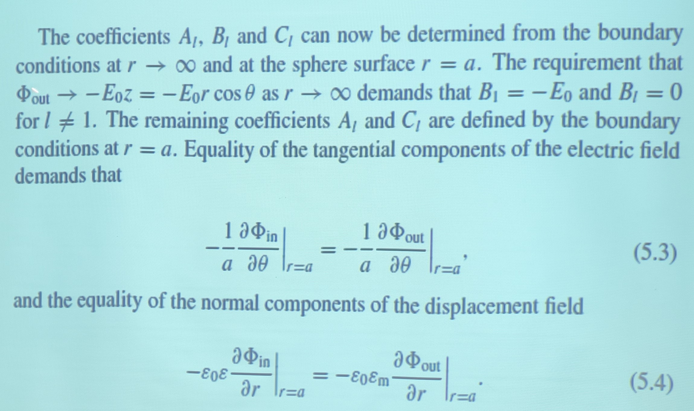

*课件原片：切向 $E$ 连续（5.3）与法向 $D$ 连续（5.4）。两式都带着 $-1/a$ 与 $-\varepsilon_0\varepsilon$ 的因子，来自 $\mathbf{E}=-\nabla\Phi$*

### 3.3 系数代数（课件跳过的部分）

把 (3.2) 代入 (3.4)。由于 $P_l$ 正交，可以逐 $l$ 比较：

$$
A_l a^{l}=B_l a^{l}+C_l a^{-(l+1)}.
\tag{3.6}
$$

代入 (3.5)：

$$
\varepsilon\, l A_l a^{l-1}=\varepsilon_m\left[lB_l a^{l-1}-(l+1)C_l a^{-(l+2)}\right].
\tag{3.7}
$$

**先看 $l\ne1$。** 此时 $B_l=0$，(3.6) 给出 $C_l=A_l a^{2l+1}$，代入 (3.7)：

$$
\varepsilon\, l A_l a^{l-1}=-\varepsilon_m(l+1)A_l a^{l-1}
\;\Longrightarrow\;
A_l\left[\varepsilon l+\varepsilon_m(l+1)\right]=0 .
$$

方括号内是两个正数之和（$l\ge1$ 时），不可能为零，所以 $A_l=0$，进而 $C_l=0$。**只有 $l=1$ 存留**——这条结论很关键，它说明“偶极”不是假设出来的，而是球几何 + 均匀外场自动选出来的。

**再看 $l=1$。** $B_1=-E_0$，代入 (3.6)(3.7)：

$$
A_1=-E_0+\frac{C_1}{a^{3}},
\qquad
\varepsilon A_1=\varepsilon_m\left[-E_0-\frac{2C_1}{a^{3}}\right].
$$

把第一式代进第二式，消掉 $A_1$：

$$
\varepsilon\left(-E_0+\frac{C_1}{a^{3}}\right)=-\varepsilon_m E_0-\frac{2\varepsilon_m C_1}{a^{3}}
$$

整理：

$$
\frac{C_1}{a^{3}}\left(\varepsilon+2\varepsilon_m\right)=E_0\left(\varepsilon-\varepsilon_m\right)
\;\Longrightarrow\;
C_1=E_0 a^{3}\frac{\varepsilon-\varepsilon_m}{\varepsilon+2\varepsilon_m}.
\tag{3.8}
$$

回代求 $A_1$：

$$
A_1=-E_0+E_0\frac{\varepsilon-\varepsilon_m}{\varepsilon+2\varepsilon_m}
=E_0\frac{-(\varepsilon+2\varepsilon_m)+(\varepsilon-\varepsilon_m)}{\varepsilon+2\varepsilon_m}
=-\frac{3\varepsilon_m}{\varepsilon+2\varepsilon_m}E_0 .
\tag{3.9}
$$

于是

$$
\boxed{\Phi_{\mathrm{in}}=-\frac{3\varepsilon_m}{\varepsilon+2\varepsilon_m}E_0\,r\cos\theta}
\tag{3.10}
$$

$$
\boxed{\Phi_{\mathrm{out}}=-E_0 r\cos\theta+\frac{\varepsilon-\varepsilon_m}{\varepsilon+2\varepsilon_m}E_0 a^{3}\frac{\cos\theta}{r^{2}}}
\tag{3.11}
$$

**这就是课件式 (5.5a)(5.5b)，教材式 (5.6)。** 两个式子里出现了同一个分母 $\varepsilon+2\varepsilon_m$，整个 LSP 物理都藏在它里面。

  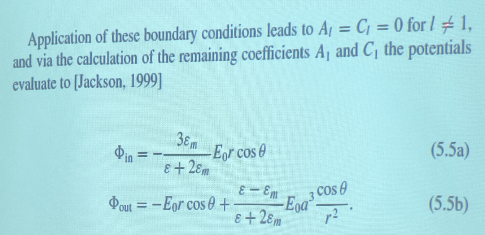

*课件原片：课件在这里直接给了结果，$A_1$ 与 $C_1$ 之间的代数（3.6–3.9）被跳过。上面补的就是这一步*

> **一眼看懂 (3.11)**：第一项是外加场，第二项的形式是 $\cos\theta/r^2$，正是**位于球心的偶极子**的势。所以“球在外场中极化成一个偶极子”这句话，(3.11) 已经写出来了。

---

## 4. 偶极子、极化率与 Clausius–Mossotti

  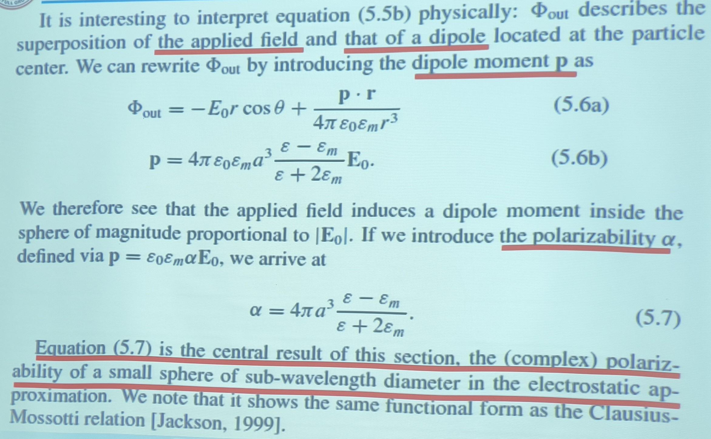

*课件原片（教材式 5.6–5.7）：把 $\Phi_{\mathrm{out}}$ 拆成外加场加偶极场，读出偶极矩，再定义极化率*

### 4.1 读出偶极矩

偶极子的势是

$$
\Phi_{\mathrm{dip}}=\frac{\mathbf{p}\cdot\mathbf{r}}{4\pi\varepsilon_0\varepsilon_m r^{3}}
=\frac{p\cos\theta}{4\pi\varepsilon_0\varepsilon_m r^{2}} .
\tag{4.1}
$$

与 (3.11) 的第二项逐项对比：

$$
\frac{p}{4\pi\varepsilon_0\varepsilon_m}=\frac{\varepsilon-\varepsilon_m}{\varepsilon+2\varepsilon_m}E_0 a^{3}
\;\Longrightarrow\;
\boxed{\mathbf{p}=4\pi\varepsilon_0\varepsilon_m a^{3}\frac{\varepsilon-\varepsilon_m}{\varepsilon+2\varepsilon_m}\mathbf{E}_0}
\tag{4.2}
$$

**这就是课件式 (5.6b)。**

### 4.2 极化率

按定义 $\mathbf{p}=\varepsilon_0\varepsilon_m\alpha\mathbf{E}_0$：

$$
\boxed{\alpha=4\pi a^{3}\frac{\varepsilon-\varepsilon_m}{\varepsilon+2\varepsilon_m}}
\tag{4.3}
$$

**这是本节的中心结果（课件与教材同为式 5.7）。** 它只管形状是球、尺寸远小于波长这两件事，对 $\varepsilon$ 的具体形式没有任何要求。

### 4.3 与 Clausius–Mossotti 同形

把体积 $V=\frac{4}{3}\pi a^{3}$ 提出来，(4.3) 变成

$$
\alpha=3V\cdot\frac{\varepsilon-\varepsilon_m}{\varepsilon+2\varepsilon_m},
\tag{4.4}
$$

后面那个分式正是 Clausius–Mossotti 因子的形式。CM 关系描述的是"稀薄颗粒系的有效介电常数"：

$$
\frac{\varepsilon_{\mathrm{eff}}-\varepsilon_m}{\varepsilon_{\mathrm{eff}}+2\varepsilon_m}
=f\cdot\frac{\varepsilon-\varepsilon_m}{\varepsilon+2\varepsilon_m},
\qquad f=N_pV ,
\tag{4.5}
$$

$N_p$ 是数密度，$f$ 是填充因子。所以单个球的极化率与"一堆球的集体响应"共用同一个因子，**唯一区别是单个球不需要考虑球间耦合**。

物理含义：**颗粒越"极化得动"（$\varepsilon$ 与 $\varepsilon_m$ 差得越远），偶极矩越大**；但分母里的 $2\varepsilon_m$ 会拉住它，不允许无限增大——直到 $\varepsilon\to-2\varepsilon_m$ 才失控。这也提示了 §9.3 的核壳结构为什么能连续调：把两种材料的 CM 因子乘起来，就成了杂化。

---

## 5. 换一条路：用退极化场重推共振条件

第 3 节是“解方程”，这一节是“讲物理”。两条路给出同一个答案，而后者能直接回答第 6 节的问题。

### 5.1 三个场

球内一点感受到的总场是两部分之和：

$$
\mathbf{E}_{\mathrm{in}}=\mathbf{E}_0+\mathbf{E}_{\mathrm{dep}} .
\tag{5.1}
$$

$\mathbf{E}_{\mathrm{dep}}$ 是球表面极化电荷产生的**退极化场**。对球，它正比于极化强度且方向相反：

$$
\mathbf{E}_{\mathrm{dep}}=-\frac{N}{\varepsilon_0\varepsilon_m}\mathbf{P},
\qquad N=\frac{1}{3}\ \text{（球）}.
\tag{5.2}
$$

$N$ 叫**退极化因子**，纯几何量，与材料无关。球的 $N=1/3$（三个主轴各 $1/3$，加起来为 1）。

### 5.2 自洽求解

极化强度又由球内场决定：

$$
\mathbf{P}=\varepsilon_0(\varepsilon-\varepsilon_m)\mathbf{E}_{\mathrm{in}} .
\tag{5.3}
$$

把 (5.2)(5.3) 代回 (5.1)：

$$
\mathbf{E}_{\mathrm{in}}=\mathbf{E}_0-\frac{\varepsilon-\varepsilon_m}{3\varepsilon_m}\mathbf{E}_{\mathrm{in}}
$$

移项：

$$
\mathbf{E}_{\mathrm{in}}\left[1+\frac{\varepsilon-\varepsilon_m}{3\varepsilon_m}\right]=\mathbf{E}_0
\;\Longrightarrow\;
\mathbf{E}_{\mathrm{in}}=\frac{\mathbf{E}_0}{1+\dfrac{\varepsilon-\varepsilon_m}{3\varepsilon_m}}
=\frac{3\varepsilon_m}{\varepsilon+2\varepsilon_m}\mathbf{E}_0 .
\tag{5.4}
$$

**与 (3.9) 完全一致**，但只用了三行代数。

### 5.3 共振条件与“因子 2”的来历

看 (5.4) 的分母：

$$
1+\frac{\varepsilon-\varepsilon_m}{3\varepsilon_m}=0
\;\Longleftrightarrow\;
\varepsilon+2\varepsilon_m=0
\;\Longleftrightarrow\;
\boxed{\mathrm{Re}\,\varepsilon(\omega)=-2\varepsilon_m}
\tag{5.5}
$$

**这就是 Fröhlich 条件（教材式 5.8）。**

三个数值得记住：

| 形状 | 退极化因子 $N$ | 共振条件 |
| --- | --- | --- |
| 球（3D 最对称） | $1/3$ | $\varepsilon=-2\varepsilon_m$ |
| 圆柱（2D 截面为圆） | $1/2$ | $\varepsilon=-\varepsilon_m$ |
| 平面界面（SPP） | — | $\varepsilon_1+\varepsilon_2=0$ |

**这张表值得停一下。** 平面 SPP 的判据 $\varepsilon_1+\varepsilon_2=0$ 与圆柱的 $\varepsilon=-\varepsilon_m$ 是同一个式子；球因为多了一个方向的约束（$N$ 从 $1/2$ 降到 $1/3$），共振点被推到**两倍**的负值上。

用一句话概括：**曲面越“紧”，需要的负介电常数越大。** 这就是为什么 LSP 要求 $\mathrm{Re}\,\varepsilon\le-2$，而 SPP 只要求 $\mathrm{Re}\,\varepsilon\le-1$；也是为什么同样用银，LSP 的共振落在可见光而 SPP 可以一路做到近红外。

---

## 6. 为什么“纳米小球”几乎都是金属球

这是本笔记要回答的核心问题。答案可以压缩成一句：**共振要求环境的 $\varepsilon_m$ 与球的 $\varepsilon$ 反号，而环境永远是正的，所以球必须是负的；在可见光里能给负 $\varepsilon$ 的材料只有金属。**

### 6.1 从共振条件看：符号被钉死了

$$
\mathrm{Re}\,\varepsilon=-2\varepsilon_m,
\qquad \varepsilon_m>0 .
$$

右边是负的（$2\varepsilon_m>0$ 取负号），所以左边必须是负的。这不是“金属更合适”这种程度的问题，而是**符号上的硬约束**：

$$
\mathrm{Re}\,\varepsilon<-2\varepsilon_m<0 .
$$

用户笔记里那句“小球界面处别的环境介质一般是正折射率，金属的纳米小球来提供负介电常数”，说的正是这件事。可以把它拆成三层：

1. **环境介质是正的**。空气、水、玻璃、光刻胶，全是 $\varepsilon_m=1\sim3$ 的正实数，虚部近似为零。这是没法改的，因为样品总要放在某种介质里。
2. **球的 $\varepsilon$ 必须补上那个负号**。$n^2=\varepsilon$ 这一层关系里没有“负折射率”的常用材料，所以只能让 $\varepsilon$ 负。
3. **负 $\varepsilon$ 意味着金属**（在可见光里）。

### 6.2 什么材料能给负 $\varepsilon$

把 Drude 与 Lorentz 两个模型并排看，答案就很清楚。

**自由载流子（Drude）**：

$$
\varepsilon(\omega)=\varepsilon_\infty-\frac{\omega_p^{2}}{\omega^{2}+i\gamma\omega}
\;\Longrightarrow\;
\mathrm{Re}\,\varepsilon<0\quad\text{当}\quad\omega<\frac{\omega_p}{\sqrt{\varepsilon_\infty}} .
\tag{6.1}
$$

负值区**从零频一直延伸到 $\omega_p$ 量级**，宽度是若干个电子伏，覆盖整个可见光加近紫外，而且（在 $\omega\tau\gg1$ 的区间）虚部很小。

**束缚电子（Lorentz）**：

$$
\varepsilon(\omega)=\varepsilon_\infty+\frac{\omega_p^{2}}{\omega_0^{2}-\omega^{2}-i\gamma\omega} .
\tag{6.2}
$$

$\mathrm{Re}\,\varepsilon<0$ 只出现在 $\omega_0<\omega<\omega_L$，其中 $\omega_L^{2}=\omega_0^{2}+\omega_p^{2}/\varepsilon_\infty$。这个窗口的**相对宽度**约为

$$
\frac{\omega_L-\omega_0}{\omega_0}\approx\frac{\omega_p^{2}}{2\varepsilon_\infty\omega_0^{2}}=\frac{f}{2},
\tag{6.3}
$$

$f$ 是振子强度。对典型介质 $f\ll1$，窗口只有百分之几宽，而且**整段都落在强吸收带里**（$\mathrm{Im}\,\varepsilon$ 在 $\omega_0$ 处最大）。

  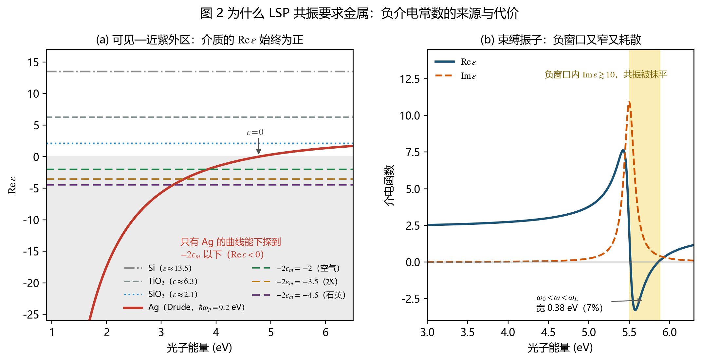

*图 2（重绘）**(a)** 可见—近紫外区三种介质的 $\mathrm{Re}\,\varepsilon$ 几乎是一条水平线，只有银的曲线一路下探穿过 $-2\varepsilon_m$；**(b)** 束缚振子的负窗口（黄色阴影）只有 0.38 eV 宽，且整段都伴随 $\mathrm{Im}\,\varepsilon\gtrsim10$ 的强吸收，共振会被彻底抹平*

### 6.3 两条门槛

把上面的数字放回 (4.3)：

$$
\alpha=4\pi a^{3}\frac{\varepsilon-\varepsilon_m}{\varepsilon+2\varepsilon_m},
\qquad
\frac{|\alpha|}{4\pi a^{3}}\bigg|_{\text{共振}}\approx\frac{3\varepsilon_m}{\mathrm{Im}\,\varepsilon}.
$$

**共振峰的高度反比于 $\mathrm{Im}\,\varepsilon$。** 所以一个材料要能当 LSP 谐振器，需要同时满足两条：

| 要求 | 金属（可见光） | 介质 | 极性晶体（红外） |
| --- | --- | --- | --- |
| $\mathrm{Re}\,\varepsilon<0$ | ✅ 宽达数 eV | ❌ 恒正 | ✅ 但只在中红外 |
| $\mathrm{Im}\,\varepsilon$ 小 | ✅ 0.1–1 | — | ✅ 0.01–0.1 |
| **结论** | **可用** | **不能用** | 可用，但波段被锁死 |

> **易错点**：不要以为“介质球也能有 Mie 共振，所以等价”。Mie 共振是**推迟效应**的共振（尺寸与内部波长可比时，波在球内走一圈相位积累 $2\pi$），属于几何共振；它的场增强只有个位数，而且尺寸不能小于 $\lambda/(2n)$。LSP 是**准静态**的电荷振荡共振，尺寸越小反而越纯。两者是不同阶的物理。

### 6.4 两个“例外”，其实是同一件事的另两种实现

**(a) 极性晶体：负 $\varepsilon$ 来自声子而不是电子。**
SiC、hBN、SiO$_2$ 在中红外有一个很强的 TO 声子振子（$f$ 接近 1，$\gamma$ 很小），$\mathrm{Re}\,\varepsilon<0$ 的窗口很宽、损耗很低，这就是 **Reststrahlen 带**。落在带内的球同样满足 $\mathrm{Re}\,\varepsilon=-2\varepsilon_m$，激发的是**表面声子极化激元（SPhP）**，不是 LSP。SiC 的带在 10.3 µm，hBN 有 7.3 µm 和 12.7 µm 两条。所以“非金属的局域共振”确实存在，只是搬到了红外。

**(b) 把环境变成负的：金属里的介质孔。**
条件 $\varepsilon=-2\varepsilon_m$ 只要求**两侧反号**，谁负谁正无所谓。把介质球埋进金属里，$\varepsilon_m$（金属）为负、$\varepsilon$（介质）为正，同样有解，共振条件是 $\varepsilon_m=-2\varepsilon$。这就是课件里提到的“金属体内的介质孔”，也是孔阵列能做异常透射的原因之一。

> **反过来读这句话**：如果哪天有一种环境介质能提供稳定的负 $\varepsilon$，那么一个普通的介质球就能做 LSP 谐振器了。这不算空想，左手材料做的衬底就在往这个方向走。

---

## 7. Fröhlich 条件与共振频率

  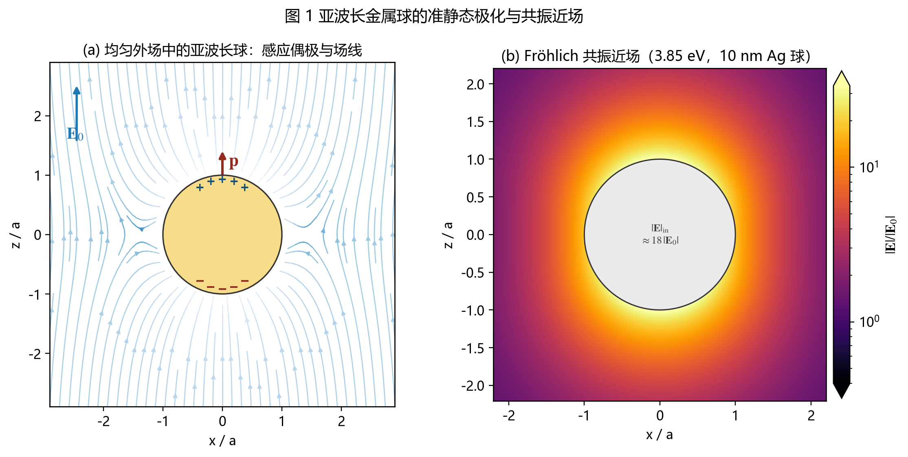

*图 1（重绘）**(a)** 均匀外场中的球：场线在球内被“挤开”，表面的正负极化电荷与感应偶极 $\mathbf{p}$ 同向；**(b)** 共振时的近场分布，场被压在球外一层很薄的壳里，两极最强（10 nm 银球，含尺寸效应修正的阻尼）*

### 7.1 Drude 金属放在介质里

把无阻尼 Drude $\varepsilon=1-\omega_p^2/\omega^2$ 代入 (5.5)：

$$
1-\frac{\omega_p^{2}}{\omega^{2}}=-2\varepsilon_m
\;\Longrightarrow\;
\boxed{\omega_0=\frac{\omega_p}{\sqrt{1+2\varepsilon_m}}}
\tag{7.1}
$$

空气中（$\varepsilon_m=1$）：

$$
\boxed{\omega_0=\frac{\omega_p}{\sqrt{3}}}
\tag{7.2}
$$

这个 $\sqrt{3}$ 是球几何的指纹：换成圆柱，同样的推导给出 $\omega_p/\sqrt{2}$。

### 7.2 环境移动

由 (7.1)，$\varepsilon_m$ 越大，$\omega_0$ 越小（红移），而且是**平方根**依赖：

$$
\frac{\Delta\omega_0}{\omega_0}\approx-\frac{\Delta\varepsilon_m}{1+2\varepsilon_m}.
\tag{7.3}
$$

用 $\varepsilon_\infty=3.7$、$\hbar\omega_p=9.2$ eV 的银 Drude 拟合算出来：

| 环境 | $\varepsilon_m$ | 共振能量 | 共振波长 |
| --- | --- | --- | --- |
| 空气 | 1.00 | 3.85 eV | 322 nm |
| 水 | 1.77 | 3.42 eV | 363 nm |
| 石英 | 2.25 | 3.21 eV | 386 nm |

  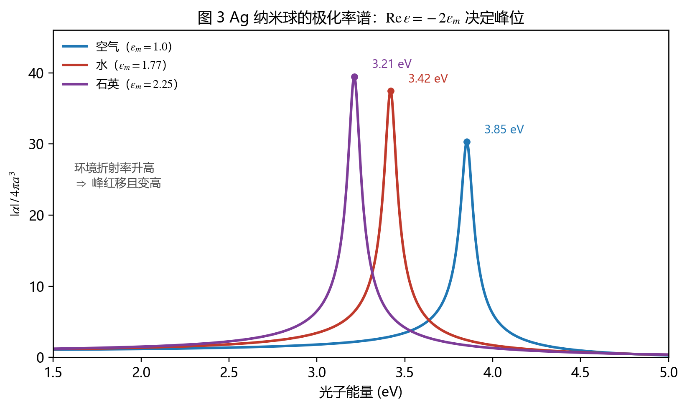

*图 3（重绘）银纳米球的 $\lvert \alpha\rvert /4\pi a^3$：环境折射率从 1 升到 2.25，峰从 3.85 eV 红移到 3.21 eV，同时峰高增加（因为 $\alpha\propto3\varepsilon_m/\mathrm{Im}\,\varepsilon$）。口径：Drude 拟合 + 半径 15 nm 球的尺寸效应修正*

**这张图就是“颜色随环境变”的全部来源**：峰位一动，透射光谱就在可见区偏色，古代教堂的彩色玻璃（金红、铜绿）用的就是这个机制，只不过当年没人知道原理。

### 7.3 尺寸效应修正

小的球不能一直用体材料的 $\gamma$。电子平均自由程约 50 nm，颗粒小到这个尺度时，表面散射成为额外的弛豫通道：

$$
\gamma(a)=\gamma_{\text{bulk}}+\frac{A\,v_F}{a},
\tag{7.4}
$$

$v_F\approx1.4\times10^{6}$ m/s，$A$ 是量级为 1 的常数。代入实用形式：

$$
\hbar\gamma(a)\approx\hbar\gamma_{\text{bulk}}+\frac{0.69}{a\,(\mathrm{nm})}\ \ \mathrm{eV}.
\tag{7.5}
$$

$a=10$ nm 时多出 0.069 eV，$a=5$ nm 时多出 0.14 eV——**比体材料的阻尼大一个量级**。后果是共振展宽、峰值下降，这是 10 nm 以下的银球“增强能力不如预期”的主要原因，也是做 SERS 时颗粒尺寸不能一味求小的原因。

---

## 8. 场增强与截面

### 8.1 内场与外场

由 (3.10)(5.4)：

$$
\mathbf{E}_{\mathrm{in}}=\frac{3\varepsilon_m}{\varepsilon+2\varepsilon_m}\mathbf{E}_0 ,
\qquad
\mathbf{E}_{\mathrm{out}}=\mathbf{E}_0+\frac{3\mathbf{n}(\mathbf{n}\cdot\mathbf{p})-\mathbf{p}}{4\pi\varepsilon_0\varepsilon_m}\frac{1}{r^{3}} .
\tag{8.1}
$$

共振时分母只剩 $\mathrm{Im}\,\varepsilon$，内场被放大

$$
\left|\frac{\mathbf{E}_{\mathrm{in}}}{\mathbf{E}_0}\right|=\frac{3\varepsilon_m}{\mathrm{Im}\,\varepsilon}
\tag{8.2}
$$

倍。银在可见光 $\mathrm{Im}\,\varepsilon\approx0.2$–$1$，所以**内场增强约 5–15 倍**；外场在球表面的增强是内场的 2 倍左右（极向）到 1 倍（赤道向），图 1b 就是这张图。

### 8.2 SERS 的 $\lvert E\rvert ^{4}$

激发场先把拉曼偶极放大 $\lvert E\rvert $ 倍，辐射又经过同一个局域环境、再放大 $\lvert E\rvert $ 倍，于是信号正比于 $\lvert E\rvert ^{4}$：

$$
I_{\mathrm{SERS}}\propto\left|\frac{E_{\mathrm{loc}}}{E_0}\right|^{4}.
\tag{8.3}
$$

所以 10 倍的场增强给出 $10^4$ 的信号增强。单颗银球做到 $10^{4}$–$10^{5}$，二聚体“热点”可以做到 $10^{8}$ 以上，这就是单分子 SERS 的物理基础。**注意四次方意味着场增强的微小改进会被极度放大，这也是 SERS 重复性差的根源。**

### 8.3 吸收与散射截面

偶极近似下的两个截面（标准结果，量纲为面积）：

$$
C_{\mathrm{abs}}=k\,\mathrm{Im}\,\alpha,
\qquad
C_{\mathrm{sca}}=\frac{k^{4}}{6\pi}\left|\alpha\right|^{2},
\qquad
C_{\mathrm{ext}}=C_{\mathrm{abs}}+C_{\mathrm{sca}} .
\tag{8.4}
$$

两者的比例决定颗粒“看起来是什么”：

$$
\frac{C_{\mathrm{sca}}}{C_{\mathrm{abs}}}=\frac{k^{3}|\alpha|}{6\pi\,\mathrm{Im}\,\alpha}\propto a^{3}.
$$

**颗粒越大，散射越占主导；越小，吸收越占主导。** 这解释了两个常见现象：10 nm 的金溶胶几乎透明（吸收为主，颜色是透射色），50 nm 的金溶胶呈浑浊的红色（散射为主，看到的是散射色）；而 $C_{\mathrm{sca}}\propto k^4\propto\lambda^{-4}$ 就是瑞利散射的蓝光增强，天空是蓝的和金溶胶是红的，是同一个 $k^4$ 的两面。

---

## 9. 形状与尺寸：另外两个旋钮

### 9.1 椭球的退极化因子

对半轴为 $a,a,c$ 的长椭球，沿长轴的退极化因子是

$$
L_z=\frac{1-e^{2}}{e^{3}}\left[\frac{1}{2}\ln\frac{1+e}{1-e}-e\right],
\qquad
e=\sqrt{1-\frac{a^{2}}{c^{2}}},
\tag{9.1}
$$

另外两个主轴各为 $(1-L_z)/2$。共振条件变成

$$
\boxed{\mathrm{Re}\,\varepsilon=\varepsilon_m\left(1-\frac{1}{L_z}\right)}
\tag{9.2}
$$

$L_z=1/3$ 时退回 (5.5)。

  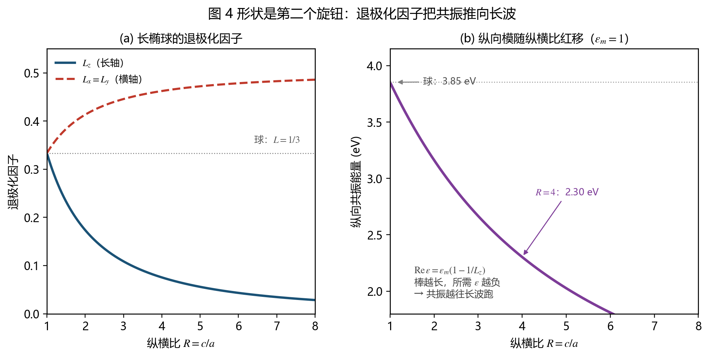

*图 4（重绘）**(a)** 长椭球的退极化因子：纵横比 $R=c/a$ 从 1 增大时 $L_z$ 从 1/3 单调下降到零；**(b)** 由 (9.2) 算出的纵向共振能量，$R=1$ 时 3.85 eV，$R=4$ 时已降到 2.30 eV*

**金纳米棒的“纵向模”就是这条曲线。** 银棒把纵横比从 1 调到 4，共振就从 322 nm 拉到 539 nm；换成金（$\mathrm{Re}\,\varepsilon$ 在红光区更负）或者把纵横比再放大到 5–6，就能进入 700–800 nm 的近红外窗口——这正是光热治疗和 NIR 传感偏爱金棒的原因。作为对照，改尺寸只能把共振挪几十纳米，改形状能挪几百纳米，所以**形状是比尺寸强得多的旋钮**。

### 9.2 尺寸：红移、展宽与高阶模

尺寸增大的三条后果，都与准静态近似的失效有关：

1. **红移**：相位延迟使球的“有效”极化减弱，共振向长波移动，近似有 $\Delta\lambda/\lambda\propto(a/\lambda)^{2}$；
2. **展宽**：辐射阻尼（$C_{\mathrm{sca}}$ 那条通道）开始吃掉能量，线宽变大；
3. **出现四极模**：$a\gtrsim40$ nm 时在偶极峰蓝侧出现一个弱峰，$a\gtrsim80$ nm 时四极可以和偶极一样强。

### 9.3 核壳与介质孔

| 结构 | 共振位置 | 特点 |
| --- | --- | --- |
| 实心球 | 由材料决定 | 银在可见蓝紫，金在绿 |
| 纳米壳（介质核 + 金属壳） | 由**核壳比**连续调 | 壳越薄越红移，可覆盖整个可见到近红外 |
| 金属里的介质孔 | 由孔的形状决定 | 与实心球互补，可做 EOT |
| 二聚体/阵列 | 由间隙决定 | 间隙模红移，间隙里场最强（SERS 热点） |

纳米壳的调谐能力来自**等离激元杂化**：球的空腔模与球的实心模耦合，分裂成能量不同的成键/反键两支，壳越薄耦合越强、红移越多。这是金纳米壳能做“一颗颗粒覆盖 600–1200 nm”的原因。

---

## 10. 应用

### 10.1 颜色

| 体系 | 共振位置 | 看到的颜色 |
| --- | --- | --- |
| 金球（~15 nm） | 520 nm | 透射红、散射绿 |
| 银球（~20 nm） | 400 nm | 透射黄 |
| 金棒（$R\approx3$） | 700 nm | 青绿 |
| 金壳（壳厚渐减） | 600→1000 nm | 蓝→灰绿 |

Lycurgus 杯（公元 4 世纪，大英博物馆）的玻璃里含 70 nm 的 Au-Ag 合金颗粒，透射光下是宝石红，反射光下是暗绿——这是 LSP 最古老的“实验证据”。

### 10.2 SERS 与单分子检测

场增强 $\lvert E\rvert ^4$ 的直接应用。要点：颗粒要形成**间隙**（二聚体、核卫星、纳米星），热点处的增强比孤立球高 2–3 个数量级；间隙 1–2 nm 时最强，再小则量子隧穿把场“短路”掉。

### 10.3 折射率传感（LSPR）

由 (7.1)，

$$
\frac{\mathrm{d}\lambda_0}{\mathrm{d}n_m}=\frac{2\lambda_0\,n_m}{1+2\varepsilon_m}
\approx\frac{2\lambda_0}{n_m}\quad(\varepsilon_m\gg1)
$$

量级是每 RIU 几十到几百纳米，比 SPP 的 SPR 传感（角度移动）小一些，但 LSPR 只需要一台紫外可见分光光度计，不需要角度扫描机构，所以便携式传感器都走这条路。

### 10.4 光伏与其他

用户笔记里提到“加纳米粒子到 PV”，这里把两条通道分开，因为它们的物理完全不同：

1. **远场散射（光 trapping）**：大颗粒（>50 nm）把光散射进电池，等效于增加光程，靠的是 $C_{\mathrm{sca}}$；
2. **近场增强（吸收提升）**：小颗粒把场局域在几十纳米内，提高附近半导体的吸收速率，靠的是 $\lvert E\rvert ^{2}$；
3. **热电子注入**：等离激元衰变产生的热电子越过 Schottky 势垒进入半导体，这是另一条通道，效率低但对亚带隙光有效。

> **一个常被忽略的限制**：金属颗粒同时也是**复合中心**和**遮挡体**。放在前表面会挡光，放在背面则要面对“近场只延伸 20 nm”的现实。这也是等离激元增强光伏在实验室里很漂亮、在组件上不明显的原因。

---

## 11. 公式速查表

| # | 公式 | 名称 | 课件 | 教材 |
| --- | --- | --- | --- | --- |
| 1 | $\Phi=\sum[A_l r^l+B_l r^{-(l+1)}]P_l(\cos\theta)$ | 拉普拉斯方程通解 | (5.1)(5.2) | (5.1)(5.2) |
| 2 | $-\frac{1}{a}\partial_\theta\Phi_{\mathrm{in}}=-\frac{1}{a}\partial_\theta\Phi_{\mathrm{out}}$ | 切向 $E$ 连续 | (5.3) | (5.3) |
| 3 | $-\varepsilon\partial_r\Phi_{\mathrm{in}}=-\varepsilon_m\partial_r\Phi_{\mathrm{out}}$ | 法向 $D$ 连续 | (5.4) | (5.4) |
| 4 | $\Phi_{\mathrm{in}}=-\frac{3\varepsilon_m}{\varepsilon+2\varepsilon_m}E_0r\cos\theta$ | 球内势 | (5.5a) | (5.5a) |
| 5 | $\Phi_{\mathrm{out}}=-E_0r\cos\theta+\frac{\varepsilon-\varepsilon_m}{\varepsilon+2\varepsilon_m}E_0a^3\frac{\cos\theta}{r^2}$ | 球外势 | (5.5b) | (5.5b) |
| 6 | $\mathbf{p}=4\pi\varepsilon_0\varepsilon_m a^3\frac{\varepsilon-\varepsilon_m}{\varepsilon+2\varepsilon_m}\mathbf{E}_0$ | 偶极矩 | (5.6b) | (5.6b) |
| 7 | $\alpha=4\pi a^3\frac{\varepsilon-\varepsilon_m}{\varepsilon+2\varepsilon_m}$ | **球极化率** | (5.7) | (5.7) |
| 8 | $\mathrm{Re}\,\varepsilon=-2\varepsilon_m$ | **Fröhlich 条件** | — | (5.8) |
| 9 | $\omega_0=\omega_p/\sqrt{1+2\varepsilon_m}$ | 共振频率 | — | §5.2 |
| 10 | $\mathbf{E}_{\mathrm{in}}=\frac{3\varepsilon_m}{\varepsilon+2\varepsilon_m}\mathbf{E}_0$ | 内场增强 | — | §5.2 |
| 11 | $C_{\mathrm{abs}}=k\,\mathrm{Im}\,\alpha$ | 吸收截面 | — | §5.3 |
| 12 | $C_{\mathrm{sca}}=\frac{k^4}{6\pi}\lvert\alpha\rvert^2$ | 散射截面 | — | §5.3 |
| 13 | $\mathrm{Re}\,\varepsilon=\varepsilon_m(1-1/L_z)$ | 椭球共振 | — | §5.3 |
| 14 | $\gamma(a)=\gamma_{\text{bulk}}+Av_F/a$ | 尺寸效应 | — | §5.3 |

### 三个“一眼看出”的判据

1. **能不能有 LSP？** 看 $\mathrm{Re}\,\varepsilon$ 能不能到 $-2\varepsilon_m$ 以下。可见光里只有金属能。
2. **共振在哪？** 先解 $\mathrm{Re}\,\varepsilon(\omega)=-2\varepsilon_m$，再按形状改 $L$、按尺寸加红移。
3. **增强有多大？** $3\varepsilon_m/\mathrm{Im}\,\varepsilon$，所以挑损耗小的金属（银优于金），并避开带间跃迁。

---

## 12. 常见误区与自检题

### 12.1 五个高频误区

> **误区 1**：$\alpha$ 在共振时发散，说明吸收无限大。
> **纠正**：只在 $\mathrm{Im}\,\varepsilon=0$ 的理想情况下发散。真实金属分母是 $(\mathrm{Re}\,\varepsilon+2\varepsilon_m)+i\,\mathrm{Im}\,\varepsilon$，最小值就是 $i\,\mathrm{Im}\,\varepsilon$，所以峰值有限且等于 $3\varepsilon_m/\mathrm{Im}\,\varepsilon$。**损耗越大的金属，共振越弱**，这与 SPP 那边“$\mathrm{Im}\,\beta$ 决定一切”是同一件事。

> **误区 2**：球的共振频率是 $\omega_p$。
> **纠正**：是 $\omega_p/\sqrt{3}$（空气）。$\omega_p$ 是 $\varepsilon=0$ 的位置，对应**体内**纵向振荡（所有电子同相位移，没有退极化场）。表面振荡多了一个去处：电荷被推到界面上堆积，退极化场削弱了恢复力，等效于“弹簧变软”，频率因此被压到 $\omega_p/\sqrt{3}$。一般环境写成 $\omega_p/\sqrt{1+2\varepsilon_m}$。

> **误区 3**：LSP 能被光直接激发，是因为颗粒小、波矢小。
> **纠正**：恰恰相反。颗粒小意味着它的场在空间上被压缩，**波矢大**（$\sim1/a$），因此能和 $\beta\gg k_0$ 的 LSP 模式匹配。物理机制是平移对称性破缺。
> 推论：如果颗粒变成周期阵列且周期远大于颗粒、远小于波长，阵列又重新获得平移对称性，就会出现类似光栅的选择定则——只有特定方向、特定偏振能激发。

> **误区 4**：$a\ll\lambda$ 只是个工程近似，误差不大。
> **纠正**：一旦 $a/\lambda\gtrsim0.1$，误差不是“几个百分点”，而是**定性变化**：出现四极峰、峰位红移几十纳米、线宽翻倍。做定量对比时必须上 Mie 解或数值方法。

> **误区 5**：金属球的场增强一定比介质球强。
> **纠正**：在中红外不一定。极性介质（SiC、hBN）在 Reststrahlen 带里的 $\mathrm{Im}\,\varepsilon$ 可以低到 $10^{-2}$，$3\varepsilon_m/\mathrm{Im}\,\varepsilon$ 能到上百倍，远高于可见光里的金属球。**“金属”不是必要条件，“低损耗的负 $\varepsilon$”才是。**

### 12.2 自检题（题下即答案，先遮住再想）

**1. $\Phi_{\mathrm{out}}$ 为什么只剩 $l=1$ 项？如果外场不是均匀的会怎样？**

**答**：均匀外场只含 $P_1(\cos\theta)$ 的角向结构，加上 $r\to\infty$ 的边界条件把 $B_l$ 全钉死成 $B_1=-E_0$，而 $l\ne1$ 的方程是 $A_l[\varepsilon l+\varepsilon_m(l+1)]=0$，方括号恒正，只能 $A_l=0$。

外场不均匀时（比如邻近另一个颗粒的场、或紧聚焦光束），$r\to\infty$ 的条件不再是单一平面波，$B_l$ 会有多个分量，球就同时被激发成偶极、四极、八极……**这也是二聚体间隙里场特别强的原因：高阶模被耦合进来了。**

**2. 用退极化场的方法重推 $\alpha$，验证与拉普拉斯解法一致。**

**答**：由 (5.3) 与 (5.4)：

$$
\mathbf{P}=\varepsilon_0(\varepsilon-\varepsilon_m)\frac{3\varepsilon_m}{\varepsilon+2\varepsilon_m}\mathbf{E}_0 .
$$

偶极矩等于极化强度乘体积：

$$
\mathbf{p}=\mathbf{P}\cdot\frac{4}{3}\pi a^{3}
=4\pi\varepsilon_0\varepsilon_m a^{3}\frac{\varepsilon-\varepsilon_m}{\varepsilon+2\varepsilon_m}\mathbf{E}_0 ,
$$

与 (4.2) 一致，因此 $\alpha=4\pi a^{3}(\varepsilon-\varepsilon_m)/(\varepsilon+2\varepsilon_m)$，与 (4.3) 一致。

**3. 为什么球的共振是 $\varepsilon=-2\varepsilon_m$ 而平面界面是 $\varepsilon_1+\varepsilon_2=0$？**

**答**：两者是同一个条件的两种几何。一般形式是

$$
\mathrm{Re}\,\varepsilon=\varepsilon_m\left(1-\frac{1}{N}\right),
$$

$N$ 是退极化因子。圆柱（二维截面为圆）$N=1/2$，给出 $\varepsilon=-\varepsilon_m$，正是平面 SPP 的判据；球 $N=1/3$，给出 $\varepsilon=-2\varepsilon_m$。

物理上，$N$ 越小意味着“电荷被约束得越紧、退极化场越弱”，因此需要更大的负 $\varepsilon$（更强的极化能力）才能把内部场推到发散。

**4. 一个 $\varepsilon=12$ 的硅球放在水里，会有 LSP 吗？**

**答**：不会。$\varepsilon=12>0$，而共振要求 $\varepsilon=-2\varepsilon_m=-3.54$，符号都不对，方程无解。

但它会有 **Mie 共振**：当 $a\gtrsim\lambda/(2n_{\mathrm{Si}})$ 时，波在球内走一圈的相位积累达到 $2\pi$，出现几何共振（磁偶极、电偶极）。硅球的磁偶极共振在 $a\approx80$ nm、可见光附近，这就是“全介质超表面”的物理基础，与 LSP 完全不同阶。

**5. 银球从空气挪到水里，颜色往哪边移？为什么？**

**答**：往长波（红）移，从 322 nm 移到 363 nm。

由 $\omega_0=\omega_p/\sqrt{1+2\varepsilon_m}$，$\varepsilon_m$ 从 1 涨到 1.77，分母从 $\sqrt3$ 涨到 $\sqrt{4.54}$，频率降 19%。物理上，环境介质的极化削弱了球表面电荷之间的相互作用，等效于“弹簧变软”，频率降低。

**6. 为什么金纳米棒的共振能调到 800 nm，而金球不行？**

**答**：球的 $\mathrm{Re}\,\varepsilon=-2$ 这个条件在金里对应 520 nm 附近，是材料属性定死的，改尺寸只能移动几十纳米。

金棒沿长轴的退极化因子 $L_z$ 可以远小于 1/3（长径比 4 时约 0.075），共振条件变成 $\mathrm{Re}\,\varepsilon=\varepsilon_m(1-1/L_z)\approx-12$，而金的 $\mathrm{Re}\,\varepsilon$ 要到 800 nm 才这么负。**所以是几何把共振点搬到了材料曲线更负的位置上。**

**7. 为什么 SERS 的增强是 $\lvert E\rvert ^{4}$ 而不是 $\lvert E\rvert ^{2}$？**

**答**：因为拉曼过程要经历两次场增强。入射光被局域场放大 $\lvert E\rvert $ 倍，激发的拉曼偶极也按 $\lvert E\rvert $ 放大；辐射出去时，同一个局域环境再把辐射场放大 $\lvert E\rvert $ 倍。信号正比于偶极的平方，所以总共是 $\lvert E\rvert ^{4}$。

严格说第二次增强的波长不同（斯托克斯频移），所以准确写法是 $\lvert E(\omega_{\mathrm{in}})\rvert ^{2}\lvert E(\omega_{\mathrm{out}})\rvert ^{2}$，近似取等号就是 $\lvert E\rvert ^{4}$。

**8. 为什么 10 nm 以下的银球增强反而下降？**

**答**：尺寸效应修正的阻尼 $\gamma(a)=\gamma_{\text{bulk}}+Av_F/a$。$a=5$ nm 时 $\hbar\gamma$ 从 0.021 eV 涨到 0.16 eV，$\mathrm{Im}\,\varepsilon$ 相应变大，而峰值 $\propto1/\mathrm{Im}\,\varepsilon$。

所以存在一个**最佳尺寸**：太大则辐射阻尼和高阶模占主导，太小则表面散射吃掉共振。银球的最佳区间大致是 20–60 nm，具体取决于激发波长和用途（SERS 偏大、传感偏小）。

---

## 附录：教材对应章节

| 教材章节 | 内容 | 本笔记 |
| --- | --- | --- |
| Ch.5 §5.1 | LSP 的定义、与 SPP 的区别 | §1 |
| **Ch.5 §5.2** | **准静态近似、拉普拉斯方程、极化率、Fröhlich 条件** | **§2–§7** |
| Ch.5 §5.3 | 超越准静态：形状因子、尺寸效应、Mie 理论 | §7.3、§9 |
| Ch.8–10 | SERS、折射率传感、等离激元应用 | §8、§10 |
| Ch.2 §2.2 | 平面 SPP 的色散（对照） | 配套笔记《SPPs》§5 |

---

*整理自 2026-11-10 课件照片与教材《Plasmonics: Fundamentals and Applications》（Maier, Springer 2007）第 5 章。所有数值算例用 $\varepsilon_\infty=3.7$、$\hbar\omega_p=9.2$ eV、$\hbar\gamma=0.021$ eV 的 Drude 拟合计算；涉及尺寸效应时按 (7.4) 修正。*
