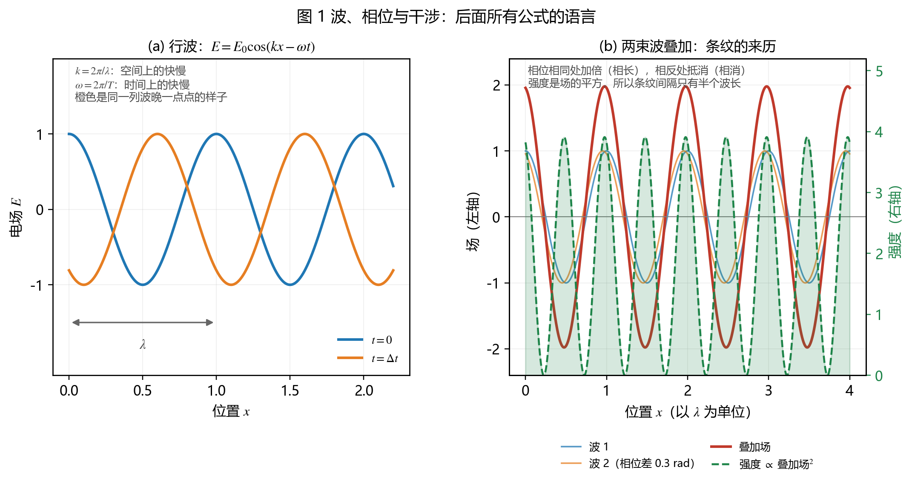
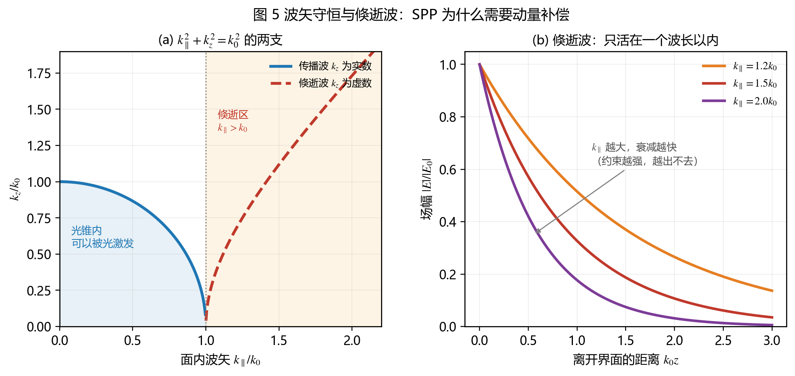
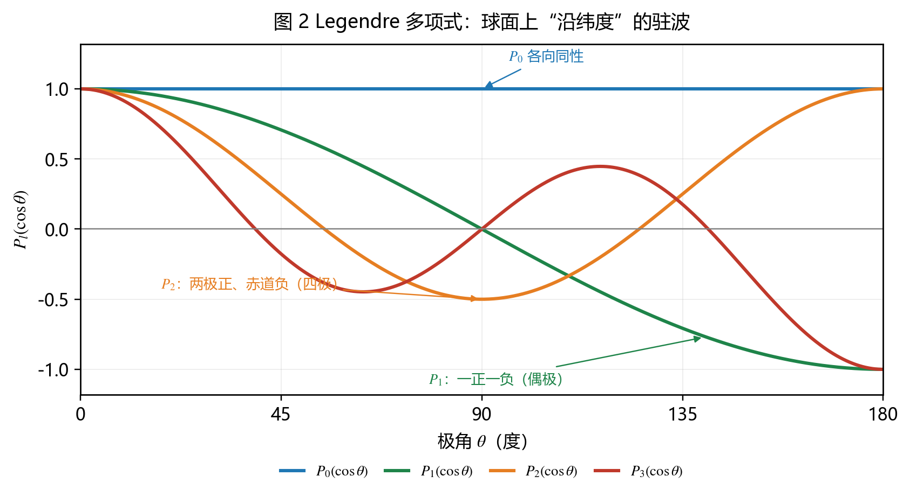
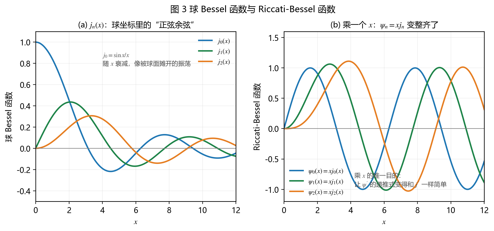
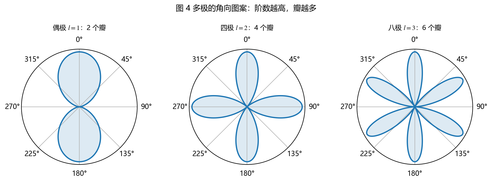

# [基础] 读等离激元笔记之前：那点必要的电磁学与数学

> **这篇是干什么的**：三份课程笔记（[SPP](/Learning/2026/10/27/course-SPP-plasmonics.html)、[LSP](/Learning/2026/11/10/course-LSP-localized-plasmon.html)、[Mie](/Learning/2026/11/17/course-Mie-theory.html)）里反复出现一些词和符号——相位匹配、倏逝波、Legendre 多项式、Bessel 函数、Clausius–Mossotti、截面……这些在教材里都是"显然"的，但对没系统学过电动力学的人是硬墙。这篇把它们一次性讲清楚：**不推导，只讲每样东西是什么、为什么会出现、在笔记里干什么用**。

---

## 目录

1. [怎么用这一篇](#1-怎么用这一篇)
2. [光是一列波：相位、波矢、复数写法](#2-光是一列波相位波矢复数写法)
3. [材料怎么响应光：介电函数](#3-材料怎么响应光介电函数)
4. [麦克斯韦方程：只需要四句话](#4-麦克斯韦方程只需要四句话)
5. [边界条件：为什么"切向连续"](#5-边界条件为什么切向连续)
6. [波矢守恒与倏逝波](#6-波矢守恒与倏逝波)
7. [球坐标与分离变量](#7-球坐标与分离变量)
8. [Legendre 多项式](#8-legendre-多项式)
9. [Bessel 函数与 Riccati-Bessel](#9-bessel-函数与-riccati-bessel)
10. [多极展开：偶极、四极、八极](#10-多极展开偶极四极八极)
11. [截面：一个等效面积](#11-截面一个等效面积)
12. [名词速查表](#12-名词速查表)

---

## 1. 怎么用这一篇

三条建议：

1. **不要从头背**。这篇是字典，读笔记时遇到不认识的词就跳回来查第 12 节。
2. **第 2–6 节是真正的地基**，值得完整读一遍。后面三份笔记的所有推导，本质上都在用这五节的东西。
3. **第 7–9 节是数学工具**，知道"它解决什么问题"就够了，不必会推。

如果你只想知道"SPP 为什么需要棱镜"，直接跳到第 6 节。如果想知道"Mie 系数里那些 $\psi$、$\xi$ 是什么鬼"，跳到第 9 节。

---

## 2. 光是一列波：相位、波矢、复数写法

### 2.1 三个量描述一列波

一列单色平面波，用三个量就能说清：

$$
E(\mathbf{r},t)=E_0\cos\left(\mathbf{k}\cdot\mathbf{r}-\omega t+\varphi_0\right).
\tag{2.1}
$$

| 量 | 名字 | 管什么 |
| --- | --- | --- |
| $E_0$ | 振幅 | 有多强 |
| $\mathbf{k}$ | **波矢** | 往哪走、波长多长：$\lvert\mathbf{k}\rvert=2\pi/\lambda$，方向就是传播方向 |
| $\omega$ | 角频率 | 抖得多快：$\omega=2\pi/T$ |
| $\mathbf{k}\cdot\mathbf{r}-\omega t+\varphi_0$ | **相位** | 此刻此地的"进度条" |

**相位是全部干涉现象的根源。** 两列波在某点相遇，看的就是它们的相位差：差 $0$（或 $2\pi$ 的整数倍）就加倍，差 $\pi$ 就抵消。

  

*图 1 **(a)** 一列行波，橙色是同一列波晚了一点点时间的样子——波往前移了，但形状不变；**(b)** 两列波叠加：场直接相加，但**强度是场的平方**，所以强度的起伏比场快一倍，条纹间隔只有 $\lambda/2$*

### 2.2 为什么强度是"半个波长"

这是后面所有"干涉光刻条纹 $\Lambda=\lambda/2$"的来源，值得在这里算清楚。

两列同向传播、相位差 $\Delta\varphi$ 的波叠加：

$$
E=E_0\cos(kx)+E_0\cos(kx+\Delta\varphi)=2E_0\cos\frac{\Delta\varphi}{2}\cos\left(kx+\frac{\Delta\varphi}{2}\right).
$$

强度正比于场的平方：

$$
I\propto E^{2}\propto\cos^{2}\left(kx+\frac{\Delta\varphi}{2}\right)=\frac{1+\cos\left(2kx+\Delta\varphi\right)}{2}.
$$

注意那个 $2kx$：**空间频率翻了一倍**，所以周期从 $\lambda$ 变成 $\lambda/2$。

> **一句话记住**：场是一阶量，强度是二阶量，二阶量的"波长"是一阶量的一半。SPP 光刻的条纹周期、全息干板的条纹间隔、两束激光打出的干涉条纹，全是这一条。

### 2.3 为什么大家都写复数

物理上只有实部有意义，但计算时写成复数方便得多：

$$
E=E_0e^{i(\mathbf{k}\cdot\mathbf{r}-\omega t)},\qquad \text{实际场}=\mathrm{Re}\{E\}.
\tag{2.2}
$$

好处有三个：

1. **微分变乘法**：$\partial_t\to-i\omega$，$\nabla\to i\mathbf{k}$。麦克斯韦方程组从微分方程直接变成代数方程。
2. **相位差变因子**：两列波的相位差就是一个 $e^{i\Delta\varphi}$，相加就是复数加法。
3. **振幅和相位打包**：复数的模是振幅、辐角是相位，一个数装两样东西。

代价是：**平方的时候要小心**。强度要用 $\lvert E\rvert^{2}=EE^{*}$，而不是 $E^{2}$（后者是复数，没有物理意义）。

---

## 3. 材料怎么响应光：介电函数

### 3.1 介电函数在描述什么

光打到材料上，材料里的电子被推着动，形成极化 $\mathbf{P}$。这个极化自己又产生额外的场，宏观上等效成一个"响应系数"，就是介电函数：

$$
\mathbf{D}=\varepsilon_0\varepsilon_r\mathbf{E},\qquad \varepsilon_r=1+\chi .
\tag{3.1}
$$

**$\varepsilon_r$ 不是材料的固有常数，而是频率的函数** $\varepsilon_r(\omega)$，因为电子对不同频率的响应不一样（有的跟得上、有的跟不上）。

### 3.2 实部和虚部各管什么

$\varepsilon=\varepsilon'+i\varepsilon''$ 两个部分分工明确：

| 部分 | 物理 | 后果 |
| --- | --- | --- |
| 实部 $\varepsilon'$ | 储能（极化可逆） | 决定相速度、折射率、共振位置 |
| 虚部 $\varepsilon''$ | 损耗（能量变成热） | 决定吸收、共振线宽、传播长度 |

对应到复折射率 $n+i\kappa=\sqrt{\varepsilon}$：$n$ 管"跑多快"，$\kappa$ 管"衰减多快"。

### 3.3 两种响应机制：Drude 与 Lorentz

**自由电子（金属，Drude）**：电子不被束缚，外场一推就动，没有恢复力。

$$
\varepsilon(\omega)=\varepsilon_\infty-\frac{\omega_p^{2}}{\omega^{2}+i\gamma\omega}.
\tag{3.2}
$$

$\omega_p$ 是等离子体频率（电子气集体振荡的本征频率），$\gamma$ 是碰撞损耗。**关键性质**：当 $\omega<\omega_p$ 时，实部为负。

**束缚电子（绝缘体/介质，Lorentz）**：电子被原子核拉住，像个弹簧振子，有一个共振频率 $\omega_0$。

$$
\varepsilon(\omega)=\varepsilon_\infty+\frac{\omega_p^{2}}{\omega_0^{2}-\omega^{2}-i\gamma\omega}.
\tag{3.3}
$$

在 $\omega_0$ 附近强烈吸收（这就是介质的吸收带），远离 $\omega_0$ 时实部基本都是正的、缓慢变化。

### 3.4 实部为负意味着什么

这是等离激元物理的核心，值得单独说。

$\varepsilon<0$ 不是"不导电"，也不是"场进不去"，而是：**电子的响应幅度超过了外场本身，产生的极化场把外场顶了回去**。数学上，$n=\sqrt{\varepsilon}$ 变成纯虚数，波矢 $k=n\omega/c$ 也变成虚数，于是波变成 $e^{-\kappa z}$——**在里面指数衰减，传不进去**。

但能量并没有消失，它被挤到了**界面**上，以表面波的形式存在。这就是表面等离激元的物理起源：

> **正 $\varepsilon$ 的介质 + 负 $\varepsilon$ 的金属 = 界面上可以关住一列波。**

《LSP 笔记》第 6 节把这个条件量化成了 $\mathrm{Re}\,\varepsilon=-2\varepsilon_m$，本篇第 6 节讲界面情形 $\varepsilon_1+\varepsilon_2=0$。

---

## 4. 麦克斯韦方程：只需要四句话

不需要会推导，但要能读懂每一句在说什么。

| 方程 | 一句话 |
| --- | --- |
| $\nabla\cdot\mathbf{D}=\rho$ | **电荷是电场的源头**。电场线从正电荷出发、到负电荷终止 |
| $\nabla\cdot\mathbf{B}=0$ | **没有磁单极**。磁感线永远是闭合的 |
| $\nabla\times\mathbf{E}=-\dfrac{\partial\mathbf{B}}{\partial t}$ | **变化的磁场产生电场**（发电机、电磁感应） |
| $\nabla\times\mathbf{H}=\mathbf{J}+\dfrac{\partial\mathbf{D}}{\partial t}$ | **电流和变化的电场产生磁场** |

**光学里通常没有自由电荷和电流**（$\rho=0$、$\mathbf{J}=0$），后两条变成"电场和磁场互相生成"。把它们联立消元，就得到波动方程：

$$
\nabla^{2}\mathbf{E}=\frac{n^{2}}{c^{2}}\frac{\partial^{2}\mathbf{E}}{\partial t^{2}},
\qquad n=\sqrt{\varepsilon}.
\tag{4.1}
$$

**这一条方程就是全部光学的出发点**。SPP 的色散关系、Mie 的展开、薄膜的干涉，都是它加上边界条件的解。

> **为什么值得强调**：很多笔记直接从"波动方程"开始，读者会觉得凭空冒出来。其实它就是麦克斯韦方程在无源介质里的等价形式，没有任何新假设。

---

## 5. 边界条件：为什么"切向连续"

### 5.1 四条边界条件

在两个介质的界面上，场不能随便跳，必须满足：

| 条件 | 含义 |
| --- | --- |
| $E_{1t}=E_{2t}$ | **切向电场连续** |
| $H_{1t}=H_{2t}$ | **切向磁场连续**（界面无表面电流时） |
| $D_{1n}-D_{2n}=\sigma$ | 法向电位移的跳变等于表面电荷密度 |
| $B_{1n}=B_{2n}$ | 法向磁感应强度连续 |

### 5.2 切向电场为什么连续

用一个"环路"就能看出来。在界面上取一个极扁的矩形回路，两条长边分别在上、下两种介质里，短边长度 $\Delta h\to0$。

对回路用法拉第定律：$\oint\mathbf{E}\cdot d\mathbf{l}=-\dfrac{d\Phi_B}{dt}$。回路面积趋于零，右边趋于零；短边贡献也趋于零。于是只剩两条长边的贡献，而它们的**方向相反**，所以：

$$
E_{1t}\Delta l-E_{2t}\Delta l=0\ \Longrightarrow\ E_{1t}=E_{2t}.
$$

**物理意义**：如果切向电场不连续，沿界面走一小圈就会得到有限的电动势，相当于界面上有一层无限薄的"磁通变化"——这在物理上不可能。

### 5.3 这套条件为什么这么重要

因为**它是唯一能把两种介质的解"缝合"起来的工具**。

波动方程在每种介质里都有无穷多个解（不同的 $k$ 组合）。哪一个是实际问题里的解？由边界决定。具体做法永远是同三步：

1. 在每种介质里写出**通解**（带未知系数）；
2. 在界面上套**边界条件**，得到关于系数的方程组；
3. 解方程组。

- 《SPP 笔记》第 5 节：两种介质各一个衰减解，套 $E_t$、$H_t$ 连续，两个方程解出 $\beta$（色散关系）。
- 《LSP 笔记》第 3 节：球内球外各一个通解，套两个条件，解出 $A_l$、$C_l$。
- 《Mie 笔记》第 3 节：球内、球外、散射场三组展开，套两个条件，解出 $a_n$、$b_n$。

**三份笔记的第 3、5 节其实是同一件事的三次重复**，只是几何越来越复杂。

---

## 6. 波矢守恒与倏逝波

### 6.1 界面上的"动量守恒"

界面沿面内方向是平移不变的（你沿着界面走，环境不变）。平移不变性要求**面内波矢守恒**：

$$
k_{1x}=k_{2x}\equiv k_\parallel .
\tag{6.1}
$$

这就是"相位匹配条件"，也叫"动量守恒"。所有关于耦合、光栅、棱镜的讨论，本质都是这一条。

### 6.2 倏逝波：$k_\parallel$ 太大时会发生什么

波矢的总长度由介质决定：$k^{2}=k_\parallel^{2}+k_z^{2}$。于是

$$
k_z=\sqrt{k^{2}-k_\parallel^{2}}.
\tag{6.2}
$$

- $k_\parallel<k$：$k_z$ 是实数，波正常传播（在光锥内）。
- $k_\parallel>k$：$k_z$ 变成**纯虚数**，记 $k_z=i\kappa$，场变成 $e^{-\kappa z}$——**沿垂直方向指数衰减，不传播**。

  

*图 5 **(a)** $k_\parallel$ 与 $k_z$ 的关系：$k_\parallel<k_0$ 时在光锥内、可以传播；$k_\parallel>k_0$ 时 $k_z$ 变虚、进入倏逝区；**(b)** 倏逝场的衰减，$k_\parallel$ 越大衰减越快，通常只活一个波长以内*

### 6.3 倏逝波不是"没有波"

这一点最容易误解。倏逝波：

- **有场**，而且可以很强（在界面附近）；
- **不传能量**（沿垂直方向的时间平均能流为零）；
- **可以被"救活"**：如果对面几十纳米内放了另一种介质，它又能变成传播波（这就是棱镜耦合、光子隧道效应）。

### 6.4 SPP 为什么需要棱镜或光栅

SPP 的传播常数满足

$$
\beta=k_0\sqrt{\frac{\varepsilon_1\varepsilon_2}{\varepsilon_1+\varepsilon_2}},
$$

因为 $\varepsilon_1<0$、$\varepsilon_1+\varepsilon_2<0$，算出来总是 $\beta>k_0$。也就是说 **SPP 天生就在倏逝区**，自由空间的光（$k_\parallel\le k_0$）永远匹配不上。

解决办法只有一条：**给光补上缺失的那部分波矢**。

| 手段 | 补的动量 |
| --- | --- |
| 棱镜（ATR） | $k_0 n_p\sin\theta$，靠高折射率把 $k$ 做大 |
| 光栅 | $m\cdot2\pi/a$，靠周期性提供离散的倒格矢 |
| 近场探针/粗糙表面 | 局域的 $\sim1/a$ 宽谱分量 |

**而纳米颗粒不需要补**——它自己就是一台动量补偿器，因为它的尺寸 $a$ 把场截断了，傅里叶变换必然给出 $\sim1/a$ 的大波矢。这是《LSP 笔记》第 1.2 节的内容。

---

## 7. 球坐标与分离变量

### 7.1 为什么要换坐标

球的问题用直角坐标解，边界条件（$r=a$）会写成一个平方根，没法分离。换成球坐标，边界就是一句 $r=a$。

球坐标 $(r,\theta,\phi)$：$r$ 是半径，$\theta$ 是极角（从 $z$ 轴量起），$\phi$ 是方位角（绕 $z$ 转）。

拉普拉斯方程 $\nabla^{2}\Phi=0$ 在球坐标下展开是三项之和，每一项只含一个变量：

$$
\frac{1}{r^{2}}\frac{\partial}{\partial r}\left(r^{2}\frac{\partial\Phi}{\partial r}\right)
+\frac{1}{r^{2}\sin\theta}\frac{\partial}{\partial\theta}\left(\sin\theta\frac{\partial\Phi}{\partial\theta}\right)
+\frac{1}{r^{2}\sin^{2}\theta}\frac{\partial^{2}\Phi}{\partial\phi^{2}}=0 .
\tag{7.1}
$$

### 7.2 分离变量：把偏微分拆成三个常微分

假设解可以写成三个一元函数的乘积：

$$
\Phi(r,\theta,\phi)=R(r)\,\Theta(\theta)\,\Psi(\phi).
\tag{7.2}
$$

代进 (7.1)、两边同乘 $r^{2}\sin^{2}\theta/(R\Theta\Psi)$，会发现**每一项只含一个变量**。三个"只含不同变量的项加起来等于零"，唯一的可能是每一项都是常数：

$$
\underbrace{\frac{1}{\Psi}\frac{d^{2}\Psi}{d\phi^{2}}}_{=-m^{2}}
+\underbrace{\frac{1}{\Theta}\frac{1}{\sin\theta}\frac{d}{d\theta}\left(\sin\theta\frac{d\Theta}{d\theta}\right)-\frac{m^{2}}{\sin^{2}\theta}}_{=l(l+1)}
+\underbrace{\frac{1}{R}\frac{d}{dr}\left(r^{2}\frac{dR}{dr}\right)}_{=0}=0 .
\tag{7.3}
$$

于是得到三个常微分方程：

| 方向 | 方程 | 解 | 名字 |
| --- | --- | --- | --- |
| $\phi$ | $\Psi''+m^{2}\Psi=0$ | $e^{im\phi}$ | 周期性要求 $m$ 为整数 |
| $\theta$ | Legendre 方程 | $P_l^{m}(\cos\theta)$ | 见第 8 节 |
| $r$ | 欧拉方程 | $r^{l}$、$r^{-(l+1)}$ | 幂函数 |

**这就是《LSP 笔记》第 3.1 节那个通解**

$$
\Phi=\sum_l\left[A_l r^{l}+B_l r^{-(l+1)}\right]P_l(\cos\theta)
$$

**的全部来历**：$r^{l}$ 来自径向方程，$P_l$ 来自角向方程，求和来自"所有 $l$ 都满足方程，所以要线性叠加"。

> **为什么要丢 Q_l**：Legendre 方程有两个线性无关解 $P_l$ 和 $Q_l$。$Q_l$ 在 $\theta=0$ 或 $\pi$（也就是 $z$ 轴）上发散，而物理上场必须是有限的，所以丢掉。同理，$r^{-(l+1)}$ 在原点发散，所以球内不用它。

---

## 8. Legendre 多项式

### 8.1 它是什么

Legendre 方程

$$
\frac{d}{dx}\left[\left(1-x^{2}\right)\frac{dP}{dx}\right]+l(l+1)P=0,
\qquad x=\cos\theta
\tag{8.1}
$$

在 $l$ 为非负整数时有一个**多项式解**，就是 Legendre 多项式。前几个（不用记，知道长什么样就行）：

$$
P_0(x)=1,\qquad P_1(x)=x,\qquad P_2(x)=\frac{3x^{2}-1}{2},\qquad P_3(x)=\frac{5x^{3}-3x}{2}.
\tag{8.2}
$$

  

*图 2 前四个 Legendre 多项式。$P_0$ 是常数（各向同性），$P_1$ 从 $+1$ 变到 $-1$（一正一负，偶极），$P_2$ 两极正、赤道负（四极）。**$l$ 越大，过零点越多**——这就是"多极"的角向图像*

### 8.2 为什么会出现

因为球面上"沿纬度方向"的驻波就是这个形状。一根弦上的驻波是 $\sin(n\pi x/L)$；球面上沿 $\theta$ 方向的驻波就是 $P_l(\cos\theta)$。

$l$ 就是**节点的数目**：$P_l$ 在 $0<\theta<\pi$ 之间有 $l$ 个零点。物理上，$l=1$ 对应偶极（一正一负两瓣），$l=2$ 对应四极（两正两负），依此类推。

### 8.3 正交性：为什么可以"逐 $l$ 比较系数"

不同阶的 Legendre 多项式在 $\theta\in[0,\pi]$ 上正交：

$$
\int_0^{\pi}P_l(\cos\theta)P_{l'}(\cos\theta)\sin\theta\,d\theta=\frac{2}{2l+1}\delta_{ll'} .
\tag{8.3}
$$

**这个性质是《LSP 笔记》3.3 节能"逐 $l$ 比较"的唯一依据**：把两个级数在边界上相等，两边乘上 $P_l$ 再积分，除了同阶项以外全都归零，于是每个 $l$ 可以单独解。

没有这条正交性，边界条件就是一个无穷维线性方程组，解不动。

---

## 9. Bessel 函数与 Riccati-Bessel

### 9.1 为什么是 Bessel 而不是 sin/cos

直角坐标里，波动方程的解是 $e^{ikx}$（等价于 sin/cos）。换成柱坐标或球坐标，径向方程**不再是常系数**，解就变成 Bessel 函数。

| 坐标 | 径向解 | 长相 |
| --- | --- | --- |
| 直角 | $e^{ikx}$、$\sin$、$\cos$ | 等幅振荡 |
| 柱 | $J_m(k\rho)$（Bessel） | 衰减振荡 |
| 球 | $j_n(kr)$（**球 Bessel**） | 衰减更快的振荡 |

  

*图 3 **(a)** 球 Bessel 函数：$j_0=\sin x/x$，是一个"被 $1/x$ 压住的振荡"；**(b)** 乘一个 $x$ 之后（Riccati-Bessel），振荡幅度变得整齐，前几个阶的形式也统一了*

**为什么球 Bessel 会衰减**：球面波往外扩散，同样的能量摊在越来越大的球面上，幅度必然按 $1/r$ 掉。这是几何效应，不是损耗。

前两阶的显式形式（看得出 $j_0$ 就是 $\sin x/x$）：

$$
j_0(x)=\frac{\sin x}{x},\qquad
j_1(x)=\frac{\sin x}{x^{2}}-\frac{\cos x}{x}.
$$

### 9.2 两类解、三种函数

解径向方程会得到两类解，物理用途完全不同：

| 函数 | 符号 | 行为 | 用在哪 |
| --- | --- | --- | --- |
| 第一类球 Bessel | $j_n$ | 原点有限 | 球**内**的场 |
| 第二类球 Bessel | $y_n$（或 $n_n$） | 原点发散 | 球内不能用，球外可以 |
| 第一类球 Hankel | $h_n^{(1)}=j_n+iy_n$ | $r\to\infty$ 时是**出射**球面波 | 散射场 |

**为什么散射场必须用 $h^{(1)}$**：因果性。散射波只能从球往外跑，不能从无穷远跑进来。$h^{(1)}\sim e^{ir}/r$ 正是"往外跑"的形式，而 $j_n$ 是驻波（同时含进出两个方向）。

### 9.3 Riccati-Bessel：为什么乘一个 $x$

《Mie 笔记》里的 $\psi_n$、$\xi_n$ 就是上面这些函数乘上自变量：

$$
\psi_n(\rho)=\rho\,j_n(\rho),\qquad
\xi_n(\rho)=\rho\,h_n^{(1)}(\rho).
\tag{9.1}
$$

**乘这一个 $\rho$ 的唯一目的是让递推式变整齐**。对 $j_n$，导数要用两个函数表示：

$$
j_n'(x)=j_{n-1}(x)-\frac{n+1}{x}j_n(x),
$$

而对 $\psi_n$，导数变成一个漂亮的单项递推：

$$
\psi_n'(x)=\psi_{n-1}(x)-\frac{n}{x}\psi_n(x).
\tag{9.2}
$$

后者在数值上稳定得多，也更容易写成程序。所以 Mie 系数的标准写法全用 $\psi$、$\xi$，而不是 $j$、$h$。

> **看到 $\psi_n(mx)$ 别慌**：它就是"球内"的径向函数，自变量是 $mx$（球内波矢 $mk$ 乘半径，即球内的尺寸参数）；而 $\psi_n(x)$ 是"球外"的，自变量是 $x=ka$。Mie 系数里的分子分母，本质就是**把球内和球外的解在界面上缝合**。

---

## 10. 多极展开：偶极、四极、八极

### 10.1 一个类比

拨一根弦，听到的不只是基音，还有泛音。任意一个复杂振动都能拆成"基音 + 二次谐波 + 三次谐波……"的叠加。

任意一个电荷分布（或任意一个散射场）也一样，可以拆成：

| 阶 | 名字 | 图像 | 角向节点 |
| --- | --- | --- | --- |
| $l=0$ | 单极 | 一个点电荷，各向同性 | 0 |
| $l=1$ | **偶极** | 一正一负，像根哑铃 | 1 |
| $l=2$ | **四极** | 两正两负，像四瓣花 | 2 |
| $l=3$ | 八极 | 三正三负 | 3 |

  

*图 4 方位角方向的角向强度：偶极 2 瓣、四极 4 瓣、八极 6 瓣。**阶数越高，瓣越多，需要颗粒越大才装得下***

### 10.2 为什么高阶模式需要大颗粒

$l$ 阶多极要求球面上能排下 $l$ 个波节。而球面上的"波长"由 $a$ 决定，所以要求

$$
x=ka\gtrsim l .
$$

**这是"颗粒一大就出现四极"的根本原因**，也是《Mie 笔记》第 5 节那张多极分解图的全部内容：$x$ 从 0 长到 4 的过程中，$b_1$、$a_1$、$a_2$、$b_2$、$a_3$ 依次登场。

### 10.3 电多极与磁多极

每一阶其实都有两个"味道"：

- **电多极** $a_n$：由电荷的振荡产生（电偶极 = 正负电荷来回跑）；
- **磁多极** $b_n$：由电流环的振荡产生（磁偶极 = 环形电流）。

金属球里，电偶极在 $x\ll1$ 就共振（因为 $\mathrm{Re}\,\varepsilon<0$），磁偶极可以忽略；介质球里反过来，**磁偶极先共振**。这不是两套物理，是同一个级数的两个系数。

---

## 11. 截面：一个等效面积

### 11.1 定义

截面 $C$ 的定义是：

$$
C=\frac{\text{被这颗颗粒移出原光束的功率}}{\text{入射光强}} .
\tag{11.1}
$$

量纲是**面积**。它的意思是："这颗颗粒相当于在光束里挡了多大一个洞"。

### 11.2 三种截面

| 截面 | 含义 | 备注 |
| --- | --- | --- |
| $C_{\mathrm{abs}}$ | 吸收掉的 | 光变成热 |
| $C_{\mathrm{sca}}$ | 散射到别的方向的 | 光还在，只是改道 |
| $C_{\mathrm{ext}}=C_{\mathrm{abs}}+C_{\mathrm{sca}}$ | 从原方向消失的总量 | "消光" = 变暗 |

### 11.3 为什么用"面积"而不是"效率"

两个原因：

1. **截面可以直接和几何截面比**。比值 $Q=C/(\pi a^{2})$ 是**效率因子**，无量纲，方便横向比较不同尺寸的颗粒。
2. **截面符合物理定律的自然形式**。光学定理、Kramers–Kronig 关系、能量守恒，都直接写在截面上。

### 11.4 为什么截面可以远大于几何截面

共振时，一颗 50 nm 的银球可以有 $C_{\mathrm{ext}}\approx10\pi a^{2}$——挡光的"洞"比它自己大十倍。

原因是：**它不只挡自己身上的光，还把周围一圈的光"吸"了过来**。近场把邻近区域的能量拉向颗粒，等效截面因此远大于几何截面。天线的"有效口径"是同一回事。

> **反过来也成立**：远离共振时，$C$ 可以远**小于**几何截面（比如透明介质球在可见光下）。所以"看得见/看不见"和"有多大"没有直接关系。

---

## 12. 名词速查表

按首次出现的笔记排列。**遇到不懂的词先查这里**。

| 名词 | 一句话解释 | 详见 |
| --- | --- | --- |
| **准静态近似** | 颗粒远小于波长，可认为外场在颗粒内处处同相，用静电学处理 | LSP §2 |
| **退极化场** | 表面极化电荷产生的、与外场反向的场，是曲面提供"恢复力"的来源 | LSP §5 |
| **退极化因子 $L$（或 $N$）** | 描述"退极化场有多强"的纯几何数，球为 $1/3$ | LSP §5.3 |
| **Fröhlich 条件** | 球发生等离激元共振的条件 $\mathrm{Re}\,\varepsilon=-2\varepsilon_m$ | LSP §5.3 |
| **Fröhlich 共振** | 这个名字指的是**亚波长球的偶极（$l=1$）等离激元共振**，来自 Fröhlich 1949 年对球形颗粒介电响应的分析；不是另一种物理，只是那个共振的别名 | LSP §7.0 |
| **Clausius–Mossotti** | 稀薄颗粒系的有效介电常数公式，核心因子 $(\varepsilon-\varepsilon_m)/(\varepsilon+2\varepsilon_m)$ 与单球极化率同形 | LSP §4.3 |
| **有效介质理论** | 把"颗粒+介质"整体当成一种等效介质，用 CM 或 Maxwell-Garnett 公式算有效 $\varepsilon$ | LSP §4.3 |
| **局域场增强** | 共振时颗粒附近的场被放大，SERS 的基础 | LSP §8 |
| **推迟效应（retardation）** | 颗粒一大，光在球内传播有时间差，场不再处处同相，导致红移与展宽 | LSP §9.2、Mie §1 |
| **尺寸参数 $x$** | $x=ka$，颗粒尺寸与波长的比值，Mie 理论的核心无量纲量 | Mie §0 |
| **多极展开** | 把场按 $l=1,2,3\ldots$（偶极、四极、八极）拆开求和 | 本篇 §10 |
| **消光佯谬** | 大颗粒的消光截面趋于几何截面的 **2 倍**（遮挡 + 衍射） | Mie §4.2 |
| **相位匹配** | 界面两侧面内波矢相等，$k_{1x}=k_{2x}$ | 本篇 §6、SPP §8 |
| **倏逝波** | $k_\parallel>k$ 时垂直方向指数衰减的场，不传能量但可以很强 | 本篇 §6.2 |
| **光锥** | $k_\parallel<k_0$ 的区域，只有这里的光能直接传播 | 本篇 §6.2 |
| **ATR（衰减全反射）** | 用棱镜把光的 $k_\parallel$ 做大，激发 SPP | SPP §9 |
| **传播长度 $L$** | SPP 强度衰减到 $1/e$ 的距离，$L=1/(2\mathrm{Im}\,\beta)$ | SPP §7.5 |
| **穿透深度 $\delta$** | SPP 场垂直界面衰减到 $1/e$ 的距离 | SPP §7.6 |
| **瑞利散射** | $a\ll\lambda$ 时的散射，$C_{\mathrm{sca}}\propto\lambda^{-4}$，天空是蓝的靠它 | Mie §3.3 |
| **Kerker 效应** | 电偶极与磁偶极等幅同相时，后向散射为零（定向散射） | Mie §5.2 |
| **矢量球谐** | 球坐标下张成横波的两组基 $\mathbf{M}$、$\mathbf{N}$，是 Mie 展开的骨架 | Mie §2 |

---

## 附：三份笔记怎么读

| 顺序 | 笔记 | 前置 | 一句话 |
| --- | --- | --- | --- |
| 1 | [SPP](/Learning/2026/10/27/course-SPP-plasmonics.html) | 本篇 §2–§6 | 界面上的传播型波，重点在"动量失配"与"怎么补" |
| 2 | [LSP](/Learning/2026/11/10/course-LSP-localized-plasmon.html) | 本篇 §3、§5、§7–§9 | 颗粒上的局域共振，重点在"为什么必须是金属"与"尺寸/形状怎么调" |
| 3 | [Mie](/Learning/2026/11/17/course-Mie-theory.html) | 本篇 §7–§11 | 精确解，重点在"准静态什么时候失效"与"多极怎么登场" |

**如果时间只够读一份**：读 LSP 那份。它的问题最集中（为什么是金属、为什么是这个颜色、为什么尺寸一调峰就动），而且不需要特殊函数。

**如果要动手算**：直接跳到 Mie 的第 3、4 节拿公式，再用本篇 §9 搞清楚那些 $\psi$、$\xi$ 是什么。

---

*这一篇是配套的"前置阅读"，本身不含新结果。所有结论都可以在三份笔记里找到出处，标注在每节的括号里。*
