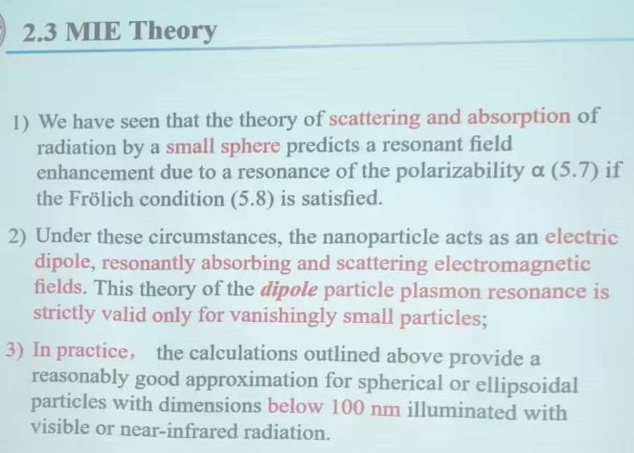
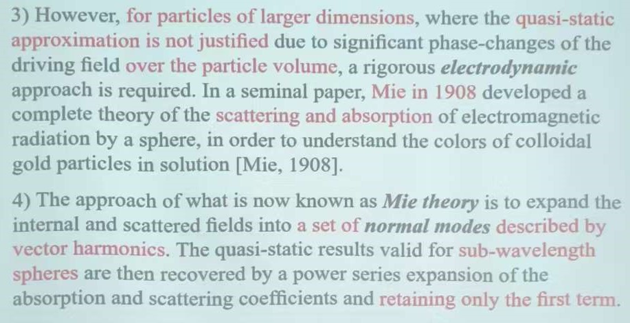
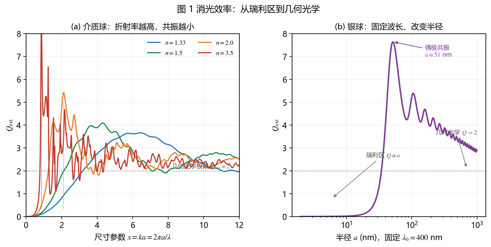
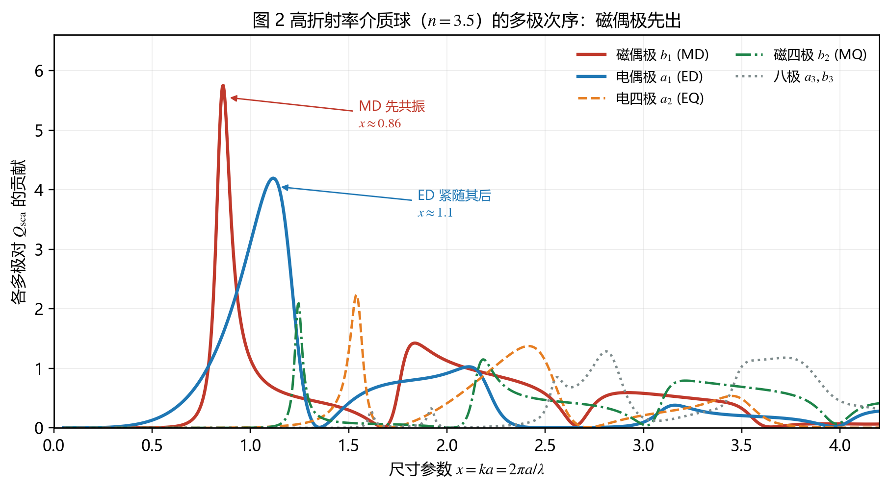
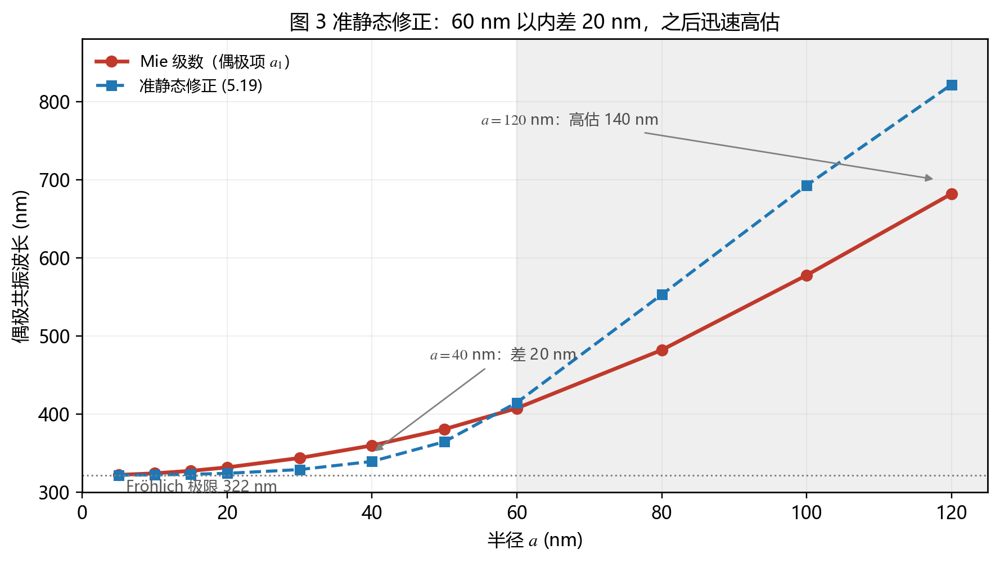
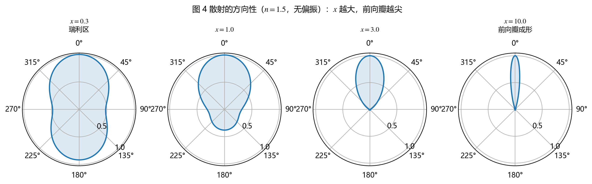

# [课程笔记] 米氏理论（Mie Theory）：从矢量谐波到多极共振

> **一句话概括**：准静态只对"无穷小球"严格成立；Mie 1908 年把内外场按矢量球谐函数展开，得到一组可以逐阶求和的系数 $a_n,b_n$，准静态就是它的第一项。本文从"为什么要展开成矢量谐波"讲到"级数怎么变成消光截面"，并用自算的 Mie 级数回答一个具体问题：准静态修正到底能用到多大粒径。

> **读这篇之前，最好先有三样东西**
>
> 1. **麦克斯韦四句话 + 边界条件**——本文第 3 节整节都在用它，见《[预备知识](/Learning/2026/11/17/basics-electromagnetics-for-plasmonics.html)》§4、§5。
> 2. **为什么球坐标要分离变量、为什么出现 Legendre 多项式**——见预备知识 §7、§8。
> 3. **Bessel 函数是干什么的**——见预备知识 §9。Mie 系数里那些 $\psi$、$\xi$ 就是它。
>
> 这三样都不熟也不必退回去：本文每一节都先给"这一段在算什么"，再给公式。**公式可以跳过，文字不要跳。**

---

## 基本信息

| 项目 | 内容 |
|---|---|
| **笔记性质** | 课程笔记（专题整理），与《局域表面等离激元（LSP）》配套 |
| **依据** | 课程 PPT（SOOCHOW UNIVERSITY）§2.3–2.4，对应教材 §5.3 后半；2026-11-17 讲 |
| **参考教材** | Maier, *Plasmonics*, Springer 2007, Ch.5 §5.3；Mie 系数的标准形式取自 Bohren & Huffman, *Absorption and Scattering of Light by Small Particles*, Wiley 1983 |
| **内容主线** | 准静态的三条边界 → 矢量球谐 → Mie 系数 → 截面 → 多极次序 → 与准静态的定量对照 |
| **配套图** | 4 张按 Mie 级数自算的曲线 + 2 张课件原片 |
| **配套笔记** | 《[局域表面等离激元（LSP）](/Learning/2026/11/10/course-LSP-localized-plasmon.html)》；《[表面等离激元极化激元（SPPs）](/Learning/2026/10/27/course-SPP-plasmonics.html)》；《[预备知识](/Learning/2026/11/17/basics-electromagnetics-for-plasmonics.html)》 |

---

## 目录

1. [准静态在哪里失效](#1-准静态在哪里失效)
2. [矢量球谐函数：为什么一个标量不够](#2-矢量球谐函数为什么一个标量不够)
3. [边界条件与 Mie 系数](#3-边界条件与-mie-系数)
4. [从系数到截面](#4-从系数到截面)
5. [多极次序与尺寸参数的三段行为](#5-多极次序与尺寸参数的三段行为)
6. [与准静态修正的定量对照](#6-与准静态修正的定量对照)
7. [散射的方向性](#7-散射的方向性)
8. [什么时候必须用 Mie](#8-什么时候必须用-mie)
9. [公式速查表](#9-公式速查表)
10. [常见误区与自检题](#10-常见误区与自检题)

---

## 记号约定

| 符号 | 含义 | 备注 |
| --- | --- | --- |
| $a$ | 球的半径 | 直径 $d=2a$ |
| $x=ka=2\pi a/\lambda$ | **尺寸参数** | 本笔记统一口径，$\lambda$ 为介质中波长 |
| $m=n_{\mathrm{p}}/n_{\mathrm{m}}$ | 相对折射率 | $m^{2}=\varepsilon/\varepsilon_m$，可为复数 |
| $\psi_n(\rho)=\rho j_n(\rho)$ | Riccati-Bessel 第一类 | $\rho$ 可以是复数 |
| $\xi_n(\rho)=\rho h_n^{(1)}(\rho)$ | Riccati-Bessel 第三类 | 含出射波，故为复值 |
| $a_n,\ b_n$ | Mie 系数 | $a_n$ 电多极（TM），$b_n$ 磁多极（TE） |
| $Q_{\mathrm{ext}}$ | 消光效率 | $C_{\mathrm{ext}}/(\pi a^{2})$，无量纲 |

> **一条容易踩的约定坑**：Maier 教材式 (5.19) 里写的尺寸参数是 $x=\pi a/\lambda_0$。若那里的 $a$ 取半径，它就等于本笔记 $x$ 的**一半**。引用 (5.19) 时必须按它自己的定义代入，不能和 Mie 的 $ka$ 混用——混用会让修正项差 4 倍。

---

## 1. 准静态在哪里失效

### 1.0 先说清楚这一步在解决什么

想象一束光打在银球上。光在里面激起电子的集体振荡，这个振荡又把光重新辐射出去一部分——被辐射走的那部分叫**散射**，被电子摩擦吃掉的那部分叫**吸收**。我们想知道的就是：**散射多少、吸收多少、往哪个方向散**。

准静态的答案是：球太小了，光在它身上"看不到"相位变化，所以整个球可以当成一个点偶极来处理。这个答案在 $a\ll\lambda$ 时非常准，而且给出了一个漂亮的判据 $\mathrm{Re}\,\varepsilon=-2\varepsilon_m$。

问题是：**真实器件不长在 $a\ll\lambda$ 的极限里**。要做的纳米结构动辄 50–200 nm，可见光波长 400–700 nm，$a/\lambda$ 到了 0.1–0.3——这时候"点偶极"的图像开始塌，必须面对两个新事实：

1. 光在球里走一圈需要时间，球的不同部位"不同步"；
2. 球面上可以排下更多个"节点"，于是偶极之外还出现了四极、八极。

**Mie 理论就是把这两件事一起处理掉的精确解**。它不给近似，给的是无穷级数；准静态那个漂亮的公式，只是它取第一项、再取 $x\to0$ 的结果。

### 1.1 三条边界

《LSP 笔记》里所有结论都建立在两个假设上：球内场处处同相（$a\ll\lambda$）、只有一个偶极模式。越界的标志有三条：

1. **相位不再均匀**。波在球内走过的相位差 $2ka=2x$ 不再远小于 $2\pi$，外场在球的不同部位"不同步"，偶极近似开始失真。
2. **高阶模式被激发**。球不再是一个点偶极，而是一个有内部结构的散射体，四极、八极依次出现。
3. **能量出口打开**。辐射阻尼变得与材料损耗可比，共振既红移又展宽。

课件把这三条压缩成一句：**准静态对"无穷小球"严格成立，对可见—近红外下小于 100 nm 的球够用，再大就必须上 Mie**。

  

*课件原片：$1)$ 准静态给出 Fröhlich 共振；$2)$ 那时颗粒就是一个"电偶极"，此说严格只对无穷小球成立；$3)$ 实用上对小于 100 nm 的球够用*

### 1.2 Mie 1908 做了什么

  

*课件原片：$3)$ 颗粒一大，相位变化显著，必须用严格的电动力学；Mie 1908 年为解释金溶胶颜色建立了球对电磁波的完整散射与吸收理论。$4)$ 做法是把内外场展开成一组由**矢量谐波**描述的正则模式，再用幂级数展开散射系数、只留第一项，就退回了准静态结果*

**这段历史值得记两句**。Mie 的出发点不是为了等离激元，而是为了搞清楚"为什么金溶胶是红的、而且颜色随颗粒大小变"。他给出的是一套**精确解**，而不是近似；准静态反而是它的极限。这也解释了为什么 Mie 理论对介质球、吸收球、多层球全都适用——里面没有任何"金属"假设。

---

## 2. 矢量球谐函数：为什么一个标量不够

### 2.1 一个标量方程不够用

在直角坐标里，三个场分量各自满足标量亥姆霍兹方程，解起来很省事。到了球坐标就不行了：$\nabla^{2}\mathbf{E}+k^{2}\mathbf{E}=0$ 的三个分量**互相耦合**，不能各自独立求解。

**用一个具体画面理解这个"耦合"**：考虑一列从球心往外跑的球面波。在赤道上，它的偏振可能是"上下"；走到北极，同一个偏振方向变成了"绕圈"。也就是说，**偏振方向随位置连续转动**。你若只用"一个标量函数"描述这个场，它在北极和赤道会被解释成完全不同的偏振，物理上就错了。

平面波没有这个问题：往 $z$ 走的波，偏振永远是 $x$ 或 $y$，不随位置变。所以平面波可以用一个标量描述，球面波不行。

**结论**：球面波必须用**两个**标量生成函数来搭，一个管"绕圈"的偏振（TE），一个管"带径向分量"的偏振（TM）。这就是下一节 $\mathbf{M}$、$\mathbf{N}$ 的由来。

### 2.2 用两个标量生成矢量场

解法是引入一个"生成函数"$\psi$（标量球谐，满足标量亥姆霍兹方程），再用旋度造出两个互相正交的矢量场：

$$
\mathbf{M}=\nabla\times(\mathbf{r}\psi),
\qquad
\mathbf{N}=\frac{1}{k}\nabla\times\mathbf{M}.
\tag{2.1}
$$

- $\mathbf{M}$ 天然是**横波**（因为它是旋度，散度为零），对应"磁场沿径向没有分量"的一族；
- $\mathbf{N}$ 由 $\mathbf{M}$ 再旋一次得到，它的径向分量不为零，对应 TM 一族。

两者合起来正好张成球面上的两个偏振自由度。**这就是"矢量谐波"的全部意思**：不是发明了新函数，而是用两个标量谐波造出了完备的横波基。

> **和平面波类比**：平面波用 $\hat{e}\_1,\hat{e}\_2$ 两个偏振基；球面波用 $\mathbf{M},\mathbf{N}$ 两个矢量谐波基。区别只在于后者的"偏振方向"逐点变化。

### 2.3 三组展开

把入射平面波、球内场、散射场分别按这套基展开（入射沿 $z$、单位振幅）：

$$
\mathbf{E}_{\mathrm{inc}}=\sum_{n=1}^{\infty}E_n\left(\mathbf{M}_{o1n}^{(1)}-i\mathbf{N}_{e1n}^{(1)}\right),
\qquad
E_n=i^{n}\frac{2n+1}{n(n+1)},
\tag{2.2}
$$

$$
\mathbf{E}_{\mathrm{int}}=\sum_{n=1}^{\infty}E_n\left(c_n\mathbf{M}_{o1n}^{(1)}-i d_n\mathbf{N}_{e1n}^{(1)}\right),
\qquad
\mathbf{E}_{\mathrm{sca}}=\sum_{n=1}^{\infty}E_n\left(i a_n\mathbf{N}_{e1n}^{(3)}-b_n\mathbf{M}_{o1n}^{(3)}\right).
\tag{2.3}
$$

上标 $(1)$ 表示驻波型（$j_n$），$(3)$ 表示出射波型（$h_n^{(1)}$）——散射场必须是出射波，这是因果性要求的。下标里的 $1$ 是方位角阶数，平面波只激发 $m=1$ 的模式。

**待定的只有四组系数**：$c_n,d_n$（球内）与 $a_n,b_n$（散射）。前两组由边界条件定出来后被丢掉，真正有用的是 $a_n,b_n$。

---

## 3. 边界条件与 Mie 系数

### 3.1 两个界面、四个条件

**先说这一步在干什么**：上一节写出了三组带未知系数的展开式（入射、球内、散射），但系数还没定。定系数的唯一工具就是"场在界面上必须连续"——球内和球外的解要在 $r=a$ 上严丝合缝地接起来，不能有跳变。

具体到球界面，用的是两条（推导见[预备知识 §5](/Learning/2026/11/17/basics-electromagnetics-for-plasmonics.html)）：

| 条件 | 物理 |
| --- | --- |
| 切向 $\mathbf{E}$ 连续 | 界面上不能有无限薄的磁通变化 |
| 切向 $\mathbf{H}$ 连续 | 界面上没有表面电流 |

代入 (2.2)(2.3) 后，利用 $\mathbf{M},\mathbf{N}$ 的正交性可以**逐 $n$ 分离**（这和 LSP 笔记里"逐 $l$ 比较"是同一招，靠的都是 Legendre 函数的正交性）。每个 $n$ 恰好得到两个方程、两个未知数 $a_n,b_n$，直接解出来。

### 3.2 结果

$$
\boxed{
a_n=\frac{m\,\psi_n(mx)\,\psi_n'(x)-\psi_n(x)\,\psi_n'(mx)}
{m\,\psi_n(mx)\,\xi_n'(x)-\xi_n(x)\,\psi_n'(mx)}
}
\tag{3.1}
$$

$$
\boxed{
b_n=\frac{\psi_n(mx)\,\psi_n'(x)-m\,\psi_n(x)\,\psi_n'(mx)}
{\psi_n(mx)\,\xi_n'(x)-m\,\xi_n(x)\,\psi_n'(mx)}
}
\tag{3.2}
$$

**这两个式子第一次看会很吓人，其实只有三件事要看**：

1. **撇号是什么意思**。$\psi_n'(x)$ 就是 $\psi_n$ 对**它自己的自变量**求导。注意 $a_n$ 里同时出现 $\psi_n(mx)$ 和 $\psi_n(x)$，前者对 $mx$ 求导、后者对 $x$ 求导——写的时候容易混，读的时候别混。
2. **分子在算"失配"**。分子是"球内解"与"球外解"在界面上的差：如果两者正好接上，分子为零，就没有散射。所以**分子衡量的是接不上的程度**。
3. **分母在算"出口"**。分母把 $\psi_n(x)$ 换成 $\xi_n(x)$，即把驻波换成出射波。这一换，分母就成了"往外辐射的通道"；分母越小，通道越畅，$a_n$ 越大。

**一句话读法**：分子说"界面接得多差"，分母说"接不上之后能量能不能走掉"。两者之比就是这颗球对第 $n$ 阶多极的散射响应。

> **为什么分母不能为零**：$\xi_n$ 含 $y_n$（第二类球 Bessel），在实轴上不为零，所以分母不会真的变零——这保证了无源球的 $a_n$ 有界（$\lvert a_n\rvert\le1$）。共振时只是"接近"发散，而实际的峰值由材料的 $\mathrm{Im}\,\varepsilon$ 封顶。

两个系数的物理分工：

| 系数 | 对应 | 最低阶的物理 |
| --- | --- | --- |
| $a_n$ | 电多极（TM，$\mathbf{N}$ 型） | $a_1$ = 电偶极，正是 LSP |
| $b_n$ | 磁多极（TE，$\mathbf{M}$ 型） | $b_1$ = 磁偶极，介质球里先出现 |

> **无源球的幺正性**：$\lvert a_n\rvert\le1$、$\lvert b_n\rvert\le1$。它们不是"越大越好"的响应函数，而是有上限的散射相移。想做"超强散射"，只能靠多极叠加（Kerker 条件）或增益介质突破。

### 3.3 小 $x$ 极限：Mie 的第一项就是准静态

把 (3.1) 按 $x$ 展开到最低阶（$\lvert mx\rvert\ll1$）：

$$
a_1\simeq-\frac{2i}{3}\,\frac{m^{2}-1}{m^{2}+2}\,x^{3}
=-\frac{2i}{3}\,\frac{\varepsilon-\varepsilon_m}{\varepsilon+2\varepsilon_m}\,x^{3}.
\tag{3.3}
$$

这个式子一出来，整条线索就闭合了。代入散射截面（下一节 (4.2)）只取 $n=1$：

$$
C_{\mathrm{sca}}=\frac{2\pi}{k^{2}}\cdot3\lvert a_1\rvert^{2}
=\frac{6\pi}{k^{2}}\cdot\frac{4}{9}x^{6}\left\lvert\frac{\varepsilon-\varepsilon_m}{\varepsilon+2\varepsilon_m}\right\rvert^{2}
=\frac{8\pi}{3}k^{4}a^{6}\left\lvert\frac{\varepsilon-\varepsilon_m}{\varepsilon+2\varepsilon_m}\right\rvert^{2},
$$

**正是《LSP 笔记》的 (8.9)。** 也就是说：瑞利散射不是"Mie 的近似"，而是 Mie 级数首项在 $x\to0$ 的极限；Fröhlich 条件 $\mathrm{Re}\,\varepsilon=-2\varepsilon_m$ 就藏在 $a_1$ 的分母里。

我用 $m=1.5$、$x=10^{-3}$ 数值验算过，(3.3) 与严格 $a_1$ 的相对误差约 $4\times10^{-8}$；由此算出的 $C_{\mathrm{sca}}$ 与瑞利公式差 $7\times10^{-6}$。**这不是"大致等价"，是同一个式子。**

---

## 4. 从系数到截面

### 4.1 级数形式

**先把"截面"这个词说清楚**（完整定义见[预备知识 §11](/Learning/2026/11/17/basics-electromagnetics-for-plasmonics.html)）。

截面不是颗粒的真实面积，而是**等效挡光面积**：

$$
C=\frac{\text{被这颗颗粒移出原光束的功率}}{\text{入射光强}} .
$$

它的妙处在于：一颗 50 nm 的银球在共振时可以有 $C\approx10\pi a^{2}$——"挡光的洞"比它自己大十倍，因为它把周围一圈的光也吸了过去；而一颗透明介质球在非共振波长，$C$ 又可以远小于几何截面，几乎"不存在"。

三个截面分工：$C_{\mathrm{abs}}$（变成热）、$C_{\mathrm{sca}}$（改了方向）、$C_{\mathrm{ext}}=C_{\mathrm{abs}}+C_{\mathrm{sca}}$（从原方向消失）。

有了 $a_n,b_n$，对远场做坡印廷积分，就得到两个级数：

$$
\boxed{
C_{\mathrm{ext}}=\frac{2\pi}{k^{2}}\sum_{n=1}^{\infty}(2n+1)\,\mathrm{Re}\left(a_n+b_n\right)
}
\tag{4.1}
$$

$$
\boxed{
C_{\mathrm{sca}}=\frac{2\pi}{k^{2}}\sum_{n=1}^{\infty}(2n+1)\left(\lvert a_n\rvert^{2}+\lvert b_n\rvert^{2}\right)
}
\tag{4.2}
$$

$$
C_{\mathrm{abs}}=C_{\mathrm{ext}}-C_{\mathrm{sca}},\qquad
Q=\frac{C}{\pi a^{2}} .
\tag{4.3}
$$

**为什么消光的前置因子是 $2\pi/k^{2}$**：它是单个"通道"的最大截面（$\lambda^{2}/2\pi$ 的量级），$(2n+1)$ 是第 $n$ 阶多极的通道数（$2n+1$ 个方位角态），$\mathrm{Re}(a_n+b_n)$ 是这些通道各自的相移贡献。所以 (4.1) 其实是一个"数通道"的式子。

> **求和到第几项够**：经验判据是 $n_{\max}\approx x+4x^{1/3}+2$。$x=10$ 时约 21 项，$x=100$ 时约 120 项。收敛很快，这也是 Mie 理论至今仍是"标准答案"的原因。

### 4.2 消光佯谬：$Q_{\mathrm{ext}}\to2$

  

*图 1（自算 Mie 级数）**(a)** 介质球：$n$ 越大，共振越往小 $x$ 移，大 $x$ 时 $Q_{\mathrm{ext}}$ 绕 2 振荡；**(b)** 银球固定 $\lambda_0=400$ nm 改变半径：瑞利区线性上升，偶极共振后回落，最终趋近 2*

大颗粒的极限是 $Q_{\mathrm{ext}}\to2$，即 $C_{\mathrm{ext}}\to2\pi a^{2}$——**是几何截面的两倍**。这不是能量不守恒，而是两部分叠加：

1. **遮挡**：颗粒挡住的那部分光，贡献 $Q=1$；
2. **衍射**：颗粒边缘的衍射把光偏折到阴影里，按巴比涅原理再贡献 $Q=1$。

所以一颗完全不透明的球，其"有效挡光面积"是 $2\pi a^{2}$。**这个 2 与材料无关，也与形状基本无关**，是波动光学的普适结果。

---

## 5. 多极次序与尺寸参数的三段行为

### 5.1 $x\ll1$：瑞利区

只有 $a_1$ 显著（$b_1\propto x^{5}$ 更小），$Q_{\mathrm{sca}}\propto x^{4}$。这一段就是 LSP 的天下，Fröhlich 条件成立。

### 5.2 $x\\sim1$：多极依次点火

**先建立图像**：拨一根弦，听到的是"基音 + 泛音"。球被光照也是一样——它不是只用一个模式响应，而是**把所有能装得下的模式都激发起来**，只是各模式的权重不同。

$l$ 阶模式要求球面上能排下 $l$ 个波节，所以要求 $x\gtrsim l$。$x$ 从 0 长大的过程，就是"球越变越大、能装下的泛音越来越多"的过程。下面这张图把这个过程量出来了：

  

*图 2（自算，$n=3.5$，加 $\mathrm{Im}\,m=0.03$ 把高 Q 的形态共振展宽成可读的包络）各多极对 $Q_{\mathrm{sca}}$ 的贡献：磁偶极 $b_1$ 在 $x\approx0.86$ 先共振，电偶极 $a_1$ 在 $x\approx1.1$ 紧随，四极与八极依次出现在更大的 $x$*

**这张图值得多看一眼**，因为它解释了全介质超表面的全部设计逻辑：

- **磁偶极先出**。高折射率介质球（$n\gtrsim3$）的第一个共振是 $b_1$ 而不是 $a_1$。原因是介质的位移电流形成了环形回路，等效于一个磁偶极；折射率越高，回路越"紧"，共振越小。硅球在 $x\approx0.86$（可见光下直径约 150–180 nm）就是这个共振。
- **电偶极紧随其后**，两者在 $x\approx1.0$–$1.2$ 附近可以重叠。当 $a_1=b_1$ 时，前向与后向散射相互抵消，出现**定向散射（Kerker 效应）**——这是超表面实现"单向辐射"的原理。
- **四极与八极**在 $x>1.5$ 后依次出现，每个都能在特定波长形成独立共振。

**这些都和"等离激元"无关**，纯粹是几何共振。金属球的 $a_1$ 之所以在很小的 $x$ 就共振，是因为 $\mathrm{Re}\,\varepsilon<0$ 把分母推到了零；介质球没有负 $\varepsilon$，只能靠"波在球内走一圈相位积累 $2\pi$"来共振，所以需要 $x\sim1$。

### 5.3 $x\gg1$：几何光学

$Q_{\mathrm{ext}}\to2$，但并非单调趋近，而是**绕 2 振荡**（图 1a 的波纹）。振荡周期约 $\Delta x=\pi/(n-1)$，来源是边缘衍射与透射光的相位竞争。这一段叫**异常衍射区**，条件是 $\lvert m-1\rvert x\gg1$ 而 $\lvert m-1\rvert\ll1$。

---

## 6. 与准静态修正的定量对照

  

*图 3（自算）**红**：Mie 级数的偶极峰（取 $a_1$ 的贡献）；**蓝虚线**：LSP 笔记里的 (5.19) 准静态修正。$a\le40$ nm 内两者差 20 nm 以内，$a\approx60$ nm 附近交叉，之后 (5.19) 系统性地高估，$a=120$ nm 时高估 140 nm*

这张图回答了一个很实际的问题：**准静态修正到底能用到多大**。

| 半径 | Mie（偶极峰） | 准静态 (5.19) | 偏差 |
| --- | --- | --- | --- |
| 10 nm | 322 nm | 322 nm | 0 |
| 20 nm | 324 nm | 322 nm | 2 nm |
| 40 nm | 360 nm | 339 nm | 21 nm |
| 60 nm | 408 nm | 415 nm | 7 nm |
| 80 nm | 482 nm | 553 nm | 71 nm |
| 120 nm | 682 nm | 822 nm | 140 nm |

**结论分两层**：

1. **$a\lesssim40$ nm**：(5.19) 够用，误差 20 nm 以内。这一段做器件设计时可以放心用解析式，算得快、还能反解。
2. **$a\gtrsim60$ nm**：(5.19) 的幂级数截断失效，且**系统偏高**（越往大红得越厉害）。此时必须用 Mie 级数或数值方法。注意 60 nm 附近的交叉只是巧合——两条曲线恰好穿过彼此，不代表公式在那里更准。

> 顺带一个副产品：这张图也解释了为什么"银球 40 nm 附近颜色开始发灰"。峰的移动是一方面，更主要的是四极出现、线宽变宽，把可见区的对比度拉平了。

---

## 7. 散射的方向性

  

*图 4（自算，$n=1.5$，自然光）散射强度随角度的分布，$0^\circ$ 为前向。$x=0.3$ 时是前后对称的哑铃，$x=1$ 后前向开始占优，$x=10$ 时前向瓣已经非常窄*

- **$x\ll1$**：瑞利散射，(1+$\cos^{2}\theta$)/2，前后对称。天空是蓝的、早晚的太阳是红的，都在这一段。
- **$x\sim1$**：前向瓣出现，背向仍在。
- **$x\gg1$**：绝大部分能量进前向瓣，宽度 $\sim1/x$。这就是为什么大颗粒的溶胶看起来"发白"——前向散射强，进入眼睛的是宽谱的散射光。

**工程含义**：暗场显微成像靠的是背向或侧向散射，所以小颗粒（$x\ll1$）反而更"亮"（相对激发强度），但绝对强度极低；大颗粒散射强却主要往前跑，进不了物镜。这就是暗场成像难以兼顾"看得见"与"看得清"的根源。

---

## 8. 什么时候必须用 Mie

| 场景 | 该用什么 | 原因 |
| --- | --- | --- |
| 金属球 $a<20$ nm，可见光 | Fröhlich + 极化率 | 误差可忽略，还能解析反解尺寸 |
| 金属球 $20<a<60$ nm | (5.19) 或 Mie | (5.19) 够用；要定量就用 Mie |
| 金属球 $a>60$ nm | **Mie 或数值** | 多极混入，(5.19) 系统性高估 |
| 介质球/高折射率球 | **Mie** | 准静态没有共振，$x\sim1$ 才有 |
| 核壳、多层球 | Mie（多层递推） | 每加一层多一组边界条件 |
| 非球形（棒、星、立方） | 数值（DDA/FDTD/BEM） | Mie 只解球与同心球 |
| 强耦合（二聚体、阵列） | 数值 | 多体散射，Mie 不适用 |

**一句话选型**：**球、且只看偶极附近 → 准静态；球、要看多极或大尺寸 → Mie；不是球 → 数值。**

---

## 9. 公式速查表

| # | 公式 | 名称 | 出处 |
| --- | --- | --- | --- |
| 1 | $\mathbf{M}=\nabla\times(\mathbf{r}\psi)$，$\mathbf{N}=\nabla\times\mathbf{M}/k$ | 矢量球谐的构造 | (2.1) |
| 2 | $\mathbf{E}\_{\mathrm{sca}}=\sum\_{n=1}^{\infty}E_n\left(i a_n\mathbf{N}^{(3)}\_{e1n}-b_n\mathbf{M}^{(3)}\_{o1n}\right)$ | 散射场展开 | (2.3) |
| 3 | $a_n=\frac{m\psi_n(mx)\psi_n'(x)-\psi_n(x)\psi_n'(mx)}{m\psi_n(mx)\xi_n'(x)-\xi_n(x)\psi_n'(mx)}$ | **电多极系数** | (3.1) |
| 4 | $b_n=\frac{\psi_n(mx)\psi_n'(x)-m\psi_n(x)\psi_n'(mx)}{\psi_n(mx)\xi_n'(x)-m\xi_n(x)\psi_n'(mx)}$ | **磁多极系数** | (3.2) |
| 5 | $a_1\simeq-\frac{2i}{3}\frac{m^{2}-1}{m^{2}+2}x^{3}$ | 瑞利极限 | (3.3) |
| 6 | $C_{\mathrm{ext}}=\frac{2\pi}{k^{2}}\sum(2n+1)\mathrm{Re}(a_n+b_n)$ | 消光截面 | (4.1) |
| 7 | $C_{\mathrm{sca}}=\frac{2\pi}{k^{2}}\sum(2n+1)(\lvert a_n\rvert^{2}+\lvert b_n\rvert^{2})$ | 散射截面 | (4.2) |
| 8 | $n_{\max}\approx x+4x^{1/3}+2$ | 截断判据 | — |
| 9 | $Q_{\mathrm{ext}}\to2$ $(x\gg1)$ | 消光佯谬 | §4.2 |

---

## 10. 常见误区与自检题

### 10.1 五个误区

> **误区 1**：Mie 理论是"金属球的等离激元理论"。
> **纠正**：它对**任何**球都成立，包括介质球、吸收球、多层球，里面没有任何金属假设。等离激元只是 $\mathrm{Re}\,\varepsilon<0$ 时 $a_1$ 分母接近零的一个特例。全介质超表面用的就是同一个 Mie 级数，只是共振来自几何而不是材料。

> **误区 2**：$a_n$ 越大，散射越强，所以应该追求 $a_n>1$。
> **纠正**：无源球的幺正性要求 $\lvert a_n\rvert\le1$。$a_n=1$ 已经是该通道的"全散射"上限。想突破只能靠多极相消/相长（Kerker）或增益介质。

> **误区 3**：颗粒一大，$Q_{\mathrm{ext}}$ 就一定趋于 1（几何截面）。
> **纠正**：趋于 **2**。遮挡贡献 1，衍射再贡献 1。这个 2 是波动光学的普遍结果，与材料几乎无关。

> **误区 4**：四极峰是"另一个等离激元模式"。
> **纠正**：是同一个模式在球内的**高阶空间分布**，不是新激发态。频域上它们是分离的峰，空间上是同一套电子振荡的不同本征函数。做器件时四极通常是"污染"——它让消光峰变形、对比度下降。

> **误区 5**：把 Maier 的 $x=\pi a/\lambda_0$ 直接塞进 Mie 公式。
> **纠正**：Mie 的尺寸参数是 $x=ka=2\pi a/\lambda$，是前者的两倍（若 $a$ 取半径）。混用会让 (5.19) 的修正项差 4 倍，红移量直接错一个量级。

### 10.2 自检题（题下即答案，先遮住再想）

**1. 为什么矢量球谐要两个（$\mathbf{M}$ 和 $\mathbf{N}$），不能只用 $\mathbf{M}$？**

**答**：因为球面波有两个偏振自由度，而 $\mathbf{M}=\nabla\times(\mathbf{r}\psi)$ 天然是横波（无径向分量），只能张成一个自由度。$\mathbf{N}$ 由 $\mathbf{M}$ 再旋一次得到，带径向分量，补上第二个自由度。

物理上：$\mathbf{M}$ 型对应 TE（磁场无径向分量），$\mathbf{N}$ 型对应 TM。任一场都能写成两者的线性组合。

**2. 介质球（$n=3.5$）的第一个共振为什么是磁偶极而不是电偶极？**

**答**：介质的位移电流在球内形成环形回路，等效于一个磁偶极；折射率越高，回路越"短"，共振的 $x$ 越小。硅球的 $b_1$ 共振在 $x\approx0.86$，而 $a_1$ 要到 $x\approx1.1$。

对比金属球：$\mathrm{Re}\,\varepsilon<0$ 直接把 $a_1$ 的分母推到零，所以电偶极在 $x\ll1$ 就共振，磁偶极可以忽略。**同一个级数，两个极端。**

**3. 用 (4.1) 算一颗 $a=100$ nm 的银球在 400 nm 的消光，需要求和到第几阶？为什么收敛这么快？**

**答**：$x=ka=2\pi\times100/400=1.57$，判据 $n_{\max}\approx1.57+4\times1.16+2\approx8.2$，取 9 阶即可。

收敛快的原因：$a_n,b_n$ 的量级约 $\sim x^{2n+1}/(2n+1)!!$，随 $n$ 阶乘式衰减；物理上，$n$ 阶多极要求波在球面上绕行 $n$ 个"波长"，$x$ 不够大时根本激发不起来。

**4. 一颗完全不吸收的介质球，$Q_{\mathrm{ext}}=Q_{\mathrm{sca}}$ 吗？大 $x$ 时为什么 $Q_{\mathrm{sca}}$ 也趋于 2？**

**答**：不吸收时 $C_{\mathrm{abs}}=0$，所以 $Q_{\mathrm{ext}}=Q_{\mathrm{sca}}$，是的。

大 $x$ 时趋于 2 的原因是**消光佯谬**：颗粒挡住的几何截面贡献 1；而衍射会把光"弯"进阴影区，使得实际被移出原方向的光再多一份，合计 2。对透明球，这 2 份能量全部进入散射通道（一部分是大角度衍射、一部分是折射），所以 $Q_{\mathrm{sca}}$ 也趋于 2。

**5. 为什么用 Mie 算"银球在 400 nm、半径从 5 nm 长到 1 μm"的 $Q_{\mathrm{ext}}$，会出现一个峰然后回落到 2？那个峰是什么？**

**答**：那个峰是偶极等离激元共振（图 1b，$a\approx50$ nm）。$a$ 增大使 $x$ 增大，共振条件在一个特定 $x$ 上被满足；过了共振点，$a_n$ 的相位转过 $\pi$，消光回落。

回落到 2 而不是 0，是因为大颗粒的消光由"遮挡 + 衍射"主导，与材料共振无关了。**等离激元只在 $x<1$ 的窗口里有话语权。**

---

## 附录：与其他笔记的接口

| 本笔记 | 对应内容 | 配套笔记 |
| --- | --- | --- |
| §3.3 瑞利极限 | $\alpha$、Fröhlich 条件 | 《LSP》§4、§7 |
| §4.1 截面级数 | $C_{\mathrm{abs}},C_{\mathrm{sca}}$ 的偶极形式 | 《LSP》§8.4 |
| §5.2 多极次序 | 尺寸修正、四极出现 | 《LSP》§9.2 |
| §6 定量对照 | (5.19) 的适用范围 | 《LSP》图 6、图 7 |
| — | 平面界面的传播型模式 | 《SPPs》§5 |

---

*本文的 Mie 级数为自算：用半整数阶 Bessel 函数构造复宗量 Riccati-Bessel 函数，实现 (3.1)(3.2)(4.1)(4.2)。校验两条：$x\to0$ 时 $C_{\mathrm{sca}}$ 与瑞利公式相对误差 $7\times10^{-6}$；$x\gg1$ 时 $Q_{\mathrm{ext}}\to2$（$x=100$ 时 2.09）。图中银的介电函数用 $\varepsilon_\infty=3.7$、$\hbar\omega_p=9.2$ eV、$\hbar\gamma=0.021$ eV 的 Drude 拟合。*
